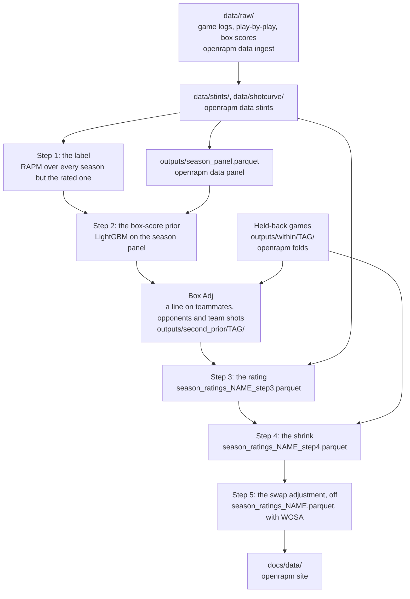

# How the ratings are built

The data commands turn the NBA's play-by-play into stints and a season panel; the model turns those into one rating
per player per season. This file gives, for each part, what it is for, what it reads, what it writes, the command, the
settings with the experiment in `notes/DECISIONS.md` that chose them, and the code. Terms are defined in
`GLOSSARY.md`. Every setting's value lives in `src/openrapm/settings.py`; this file names it and says why.

Two words used throughout:

- **stint**: a stretch of play with the same ten players on the court. A row of every regression here is one stint
  seen from one side: five players on offense, five on defense, the points per 100 possessions the offense scored,
  weighted by the stint's possessions.
- **rated season**: the season whose ratings are being built. Each season is rated from its own games only; other
  seasons may teach the models' coefficients, never a player's rating directly.



`openrapm rate` runs steps 1-3 with Box Adj, `openrapm shrink` step 4, `openrapm swap` step 5, and `openrapm build`
all of them in one process (`src/openrapm/commands/build.py`), and at the product setting WOSA after them. Each command
writes its tables once, at the end. `openrapm second-prior` writes the sums Box Adj's line is fitted from, and
`openrapm folds` the held-back games that Box Adj and step 4 are fitted on.

Every library runs on one thread, so one process keeps one core busy. `openrapm rate --jobs N`, `openrapm folds --jobs
N` and `openrapm wins --jobs N` split their seasons over N processes and give the same numbers
(`commands/parallel.py`); `OPENRAPM_JOBS` sets the default and the experiment chain asks for 4. Never more processes
than free memory holds, 5.5 GB each with 2 GB kept back, at most 5: on a machine short of memory the command runs in
one process.

## The data

| command | writes | read by |
|---|---|---|
| `openrapm data ingest FIRST LAST RS,PO` | `data/raw/`: game logs, play-by-play, box scores, the bio feed | everything |
| `openrapm data stints FIRST LAST RS,PO` | `data/stints/`, `data/shotcurve/` | every model step |
| `openrapm data events FIRST LAST` | `data/event_counts/` | the season panel's play-by-play columns, self-creation and foul counts |
| `openrapm data careers` | `data/raw/careers/`, `data/cache/careers_before.parquet` | the panel's career columns counted from a player's debut; no shipped input reads them |
| `openrapm data hustle-games FIRST LAST` | `data/raw/dashboards/hustle/games/` | the box-score prior's hustle inputs for finished seasons, from 2017 |
| `openrapm data dashboards FIRST LAST` | `data/raw/dashboards/` | the season panel, which stops without them: the tracking files from 2014; and the hustle inputs of the season in progress, season to date |
| `openrapm data tracking-games FIRST LAST` | `data/raw/dashboards/tracking/games/` | no shipped input; experiment 62 tried them |
| `openrapm data matchup-games FIRST LAST` | `data/raw/dashboards/matchups/games/` | no shipped input; experiment 120 tried them |
| `openrapm data panel` | `outputs/season_panel.parquet`, with `--so-far` `outputs/season_panel_so_far.parquet` | the box-score prior, Box Adj, Similarity |
| `openrapm data public-ratings` | `data/public_ratings/` | the Bias page |
| `openrapm data in-progress SEASON` | nothing: exit 0 while the season's Finals are not over, 3 once they are | the morning job |
| `openrapm data check-games SEASON` | nothing: exit 1 naming any game of the log without stints or with the wrong points | the morning job |

Seasons are named by the year they end, 2026 = 2025-26; phases are RS, the regular season, and PO, the playoffs. Every
fetch caches each file, so a stopped run resumes; with `OPENRAPM_OFFLINE=1` a missing file stops the run instead.

### Ingest: the raw files

- **For:** everything else is built from these files.
- **Reads:** stats.nba.com through `nba_api`: each season's game log, LeagueGameLog; every game's play-by-play,
  PlayByPlayV3, and box score, BoxScoreTraditionalV3, per period too when the play-by-play cannot say who started a
  period; api.pbpstats.com's possessions per team-game as a cross-check from 2000-01.
- **Writes:** `data/raw/gamelog/`, `pbp/`, `box/`, `periodbox/`, `pbpstats_games/`.
- **Command:** `python -m openrapm data ingest 1997 2026 RS,PO`. Days for all 37,986 games. `--refresh` fetches the
  game log again, through yesterday in US Eastern time: how the morning job finds the night's games.
- **Code:** `src/openrapm/data/ingest.py`.

### Stints

- **For:** RAPM needs the ten players on the court for every possession: one team's turn with the ball, from when it
  gains the ball until the other team does or the period ends.
- **Reads:** `data/raw/`.
- **Writes:** per season and phase, `data/stints/{season}_{phase}.parquet`: lineups, possessions, points, the
  per-possession counters and the team's shots by zone; `_diag.parquet`, one row of diagnostics per game;
  `_shots.parquet`, each game's shots per shooter; `_names.parquet`. And `data/shotcurve/`: each season's make
  probability by shot distance, fitted on every field-goal attempt of its regular season.
- **Command:** `python -m openrapm data stints 1997 2026 RS,PO`; `--force` rebuilds stints already on disk. About 46
  minutes for the 60 season-phases.
- **Code:** `src/openrapm/data/stints.py` for a season, `data/stint_parser.py` for one game: how a possession ends
  and who is on the court; `data/shot_curves.py`, `data/shots.py`.

### The play-by-play counts

- **For:** the parts of box counts the panel pads beside the counts themselves, and the counts self-creation and the
  foul inputs are made of.
- **Reads:** `data/raw/pbp/`. **Writes:** `data/event_counts/{season}.parquet`, one row per game, player and phase:
  defensive rebounds by the miss they ended, steals by the turnover they took, field-goal points and made threes by
  whether an assist is written beside them, threes from the corner and above the break, blocks by the shot and by who
  got the ball back, stolen turnovers, offensive fouls, assists by the zone of the make; every shot's spot and
  possession situation for self-creation; fouls, goaltends, shots blocked and three-shot trips.
- **Command:** `python -m openrapm data events 1997 2026`; a cached season is read unless `--force`. About 12 seconds
  a season. It prints each season's parts against its box score.
- **Code:** `src/openrapm/data/event_counts.py`, `data/creation_counts.py`, `data/foul_counts.py`.

### The hustle box scores

- **For:** the box-score prior's hustle inputs: screen assists, box-outs, loose balls, deflections, contested shots,
  charges drawn.
- **Reads:** stats.nba.com's BoxScoreHustleV2, one request a game, from 2017, the first season with every player.
  The season in progress reads the league's season-to-date hustle dashboards instead, `openrapm data dashboards`.
- **Writes:** `data/raw/dashboards/hustle/games/<season>/`, one file a game, so a set of held-back games can sum them
  over its fit games alone.
- **Command:** `python -m openrapm data hustle-games 2017 2026`.
- **Code:** `src/openrapm/data/dashboards.py`, `data/dashboard_rates.py`, which pads each rate and sets it against the
  league's: (player per 100 - league per 100) / league per 100.

### The season panel

- **For:** the box-score prior, Box Adj and the Similarity page read it.
- **Reads:** the stints, the box scores, the play-by-play counts, the hustle box scores, the roles table
  (`data/cache/roles_RSPO.parquet`: share of team possessions, starts, age, per player-season) and the bio table
  (`data/cache/bio.parquet`: height, weight, draft pick). Its first run builds both tables, fetching the bio feed, one
  request per season.
- **Writes:** `outputs/season_panel.parquet`, one row per player, season and side, offense "O" and defense "D": his
  possessions, 13 padded box-score rates per 100 possessions, role, score state, shot totals, career, body, team, his
  team's record with him on and off the court, the play-by-play parts, the hustle rates and self-creation. It also
  stores each season's design pieces, what a regression design needs from that season's stints, in
  `data/cache/pieces/`, which every later step reuses. With `--so-far 0.25,0.5,0.75`,
  `outputs/season_panel_so_far.parquet`: each season through the day a quarter, a half and three quarters of its
  regular season had been played, the box-score prior's part-season rows.
- **Command:** `python -m openrapm data panel`; an existing panel is kept unless `--force`. Under a minute.
- **Settings:** each rate is padded toward the bin rate, the rate of players with about as many possessions
  (config.yaml `pad_target: poss_conditional`): padded = (n x rate + k x bin rate) / (n + k), with n his possessions
  and k measured per count and season from every player's odd- against even-numbered games. A 200-possession player
  with 2.1 steals per 100, k = 450 and a bin rate of 1.4 is padded to (200 x 2.1 + 450 x 1.4) / 650 = 1.6. The bin
  rate is itself padded toward the league rate by the bin's possessions (config.yaml `pad_bin_target: league`,
  experiment 127): early in a season a bin's rate rests on a few dozen steals, and with it padded the ratings built
  from a tenth of a season predict the rest better in every era.
- **Code:** `src/openrapm/data/panel.py`, `box_rates.py`, `on_court.py`, `data/roles.py`, `data/bio.py`,
  `data/careers.py`, `data/designs.py`; `features.py` says what every column means.

## Step 1: the label (`rapm.py`)

- **For:** the box-score prior needs something to learn: each player's RAPM over every season except the rated one,
  one number per player per side for those seasons together.
- **Reads:** the designs of every season whose Finals are over, one per target.
- **Writes:** nothing on disk; the labels go straight to step 2.
- **How:** each season's weighted least-squares normal equations are added up once (`SeasonSums`), so leaving a
  season out is one ridge solve on the other seasons' sums, not thirty refits. A player needs 100 possessions to get
  a label.
- **Settings:**
  - the targets, one per side: offense `points_with_expected_free_throws`, made free throws replaced by the shooter's
    padded expectation; defense `points_with_expected_opponent_threes_late_as_scored`, the same with three quarters
    of the shooters' three-point luck taken off, except that a three of a period's last two seconds counts as it
    happened, since heaves go in 15-16% of the time (`notes/DECISIONS.md`, "What was settled", and experiment 95).
  - penalties 40,000 on offense and defense, 0 on the context columns ("Choose a training target's penalty on the
    end-to-end score", 2026-09-12). With 40,000, a player with 54,000 possessions keeps 57% of his raw impact and one
    with 2,600 keeps 6%.
  - the defensive label is un-shrunk, the offensive one is not (experiment 22): label = beta / max(s, s_cap) +
    (1 - s / max(s, s_cap)) x m(tier), with s = n / (n + 40,000), s_cap the same at 4,444 possessions, and m(tier)
    the un-shrunk level of his possession tier: 0-500, 500-1,500, 1,500-4,444, 4,444 and more. Un-shrinking both
    sides made the order within each side worse; un-shrinking defense alone passed every check.
- **Code:** `src/openrapm/rapm.py`; the design in `design.py` and `data/designs.py`; the targets' shooting
  adjustments in `data/shots.py`.

## Step 2: the box-score prior (`box_prior.py`)

- **For:** a player with few possessions has little evidence of his own; his box score says most of what is known
  about him.
- **Reads:** step 1's labels; the season panel, through `data.panel.trainable_panel`, which drops any season still
  being played; the part-season panel; `params/booster_params_lgb1_tune2.json`.
- **Writes:** each player's prior per side for the rated season, handed to Box Adj. With `--save-models NAME`, every
  rated season's boosters, the fitted LightGBM models, to `outputs/prior_models_NAME.pkl`, which `openrapm folds` and
  `openrapm second-prior` read.
- **How:** each player's training rows are his career row, his box score averaged over every season he has outside
  the unseen ones, and a chunk row for every run of 1, 2 and 3 consecutive seasons, all carrying his career label;
  two inputs say how much evidence a row rests on, `row_possessions` and `row_seasons`. Players are sorted by label
  and assigned to five player folds 0,1,2,3,4,4,3,2,1,0,..., and each player's prior comes from the booster fitted
  without his fold, so it cannot have learned his box score and returned his own label. Ten such sets of boosters,
  each on a resample of the players, are averaged. The boosters are then asked about the rated season's own box
  score.
- **Settings:**
  - the inputs, `hustle_no_three_pct_self_creation`, 18 on offense and 18 on defense, `features.FEATURE_SETS`: the
    season's box score, role and body, the hustle rates, and on offense self-creation (experiment 110). No career
    counts (experiment 59) and no on-court plus-minus (experiment 45), so the prior reads only the rated season;
    three-point % is off the offense (experiment 77).
  - chunk sizes 1, 2 and 3 (experiment 3).
  - part-season rows (experiment 107): each training season so far at a quarter, a half and three quarters of its
    regular season, one chunk row each, its `row_seasons` its share of the season, so a season in progress is rated
    with `row_seasons` that day's share; `--part-season-rows ""` trains without them.
  - five player folds ("The SPM memorises long-career stars, and the out-of-player prior removes it", 2026-09-14).
  - LightGBM's settings, `params/booster_params_lgb1_tune2.json`, chosen by the within-season WOWY test itself:
    `scripts/checks/152_decider_tune.py`, 100 trials of Optuna's Gaussian-process sampler on ten seasons with the
    year-over-year test as a hard limit (experiment 76). Straight-line leaves on both sides, small trees and slow
    learning: the offense's trees are two splits deep, so its prior is close to a straight line in the box score.
  - the training weight in its own column, `row_weight` (experiment 46).
  - 10 bags (experiment 78): bag k on a resample of the players at LightGBM seed k, a player drawn n times keeping his
    rows at n times their weight; a player's prior is the mean of the ten answers (`--bags`). One booster gave a
    within-season reading about 0.03 apart from seed to seed.
- **Code:** `src/openrapm/box_prior.py`, `features.py`.

## Box Adj (`second_prior.py`, `rating_line.py`)

- **For:** a box score depends on the other nine players on the court. Beside good shooters a passer's assists come
  easier; against bench units a bench player's points come easier. Box Adj corrects each player's box-score prior
  for who he played with and against, and step 3 pulls the season's RAPM toward the corrected number. On the site it
  is the Detail view's Box Adj column; in the code, "the second prior".
- **Reads:** step 2's boosters, the rated season's stints and season panel, and the line's sums,
  `outputs/second_prior/<TAG>/`.
- **Writes:** each player's prior per side, handed to step 3; the build records Box Adj's part of it as `box_adj_off`
  and `box_adj_def` in the tables.
- **How:** one straight line per side over 58 inputs, every one from the rated season:
  - his box-score prior on this side and on the other;
  - eight context numbers: his teammates' and his opponents' offensive and defensive box-score priors,
    possession-weighted, with him on the court and on the bench, each padded toward his team's level;
  - his 13 box rates, share of team possessions, share of games started, garbage-time share, height, weight; not his
    age, which no rating reads (experiment 142);
  - his team's shots made and missed by zone with him on the court and off it, on defense the opponents': the rim, 3
    feet or closer; short mid, to 13 feet; long mid, to the line; three, to 26 feet; long three, 27 feet or more;
    and free throws, offensive rebounds and turnovers;
  - on defense alone, his offensive rebound share of his rebounds, and his share of his team's possessions in the last
    five minutes of the fourth quarter or overtime with the margin within 5 less his share of all of them, padded by
    50 such team possessions (experiment 143); both read 0 on offense, a column the line weighs 0.

  Every input is centered on the season's possession-weighted average. Each team's possession-weighted total is held
  at its box-score part's, so the line only moves credit between teammates. The weights are fitted on held-back games
  through the ridge: a rating is a straight line in its prior, so the within-season WOWY test's error is a quadratic
  in the weights, and the sums `openrapm second-prior --target rating` writes give that error at any weights
  (`rating_line.py`). Both ends are solved together, each input scaled to one standard deviation, penalty 1e-4 times
  the mean diagonal. A season of the line's sums counts 0.5 to the power of its distance from the rated one over 8
  seasons.
- **Settings:** `PriorSettings.second_prior`, the sums `rd143_line`; `second_prior_inputs`,
  `context_types_no_age_team_zones_defence_only_centred` (experiments 134, 139, 142 and 143); `second_prior_team_totals`, `held`
  (experiment 81);
  `second_prior_halflife`, 8 (experiment 141). The line trains on finished seasons only, at the test setting without
  the rated season's neighbors. `--second-prior ""` reads the box-score prior alone.
- **The shipped sums:** since 2026-11-19, `openrapm second-prior --models rebuilt_base --folds
  rebuilt_base_early,rebuilt_base_within --tag rd143_line --target rating --inputs
  context_types_no_age_team_zones_defence_only_centred`, on the held-back games of the rebuild of 2026-11-17 without Box Adj
  (`scratch/2026-11-19_box_adj_reads/build143.sh`).  Over the line before it, `noage142_line`, they add four columns,
  the two inputs on each end, and agree with it on the others to 3e-15.
- **The Detail view's split:** `PriorSettings.box_first` takes the Box score column from the line's fit on his own
  stats' inputs alone, `rating_line.first_stage`, and Box Adj is the rest of the same prior. No rating reads the
  split.
- **Code:** `src/openrapm/second_prior.py`, `rating_line.py`, `commands/second_prior.py`,
  `data/second_prior_files.py`.

## Step 3: the rating (`prior_rapm.py`)

- **For:** the season's own games decide how far each player moves from his prior.
- **Reads:** the rated season's designs, both targets, and Box Adj's priors.
- **Writes:** `outputs/season_ratings_NAME_step3.parquet`.
- **How:** minimize the sum over rows of w (y - Z r - C gamma - s_O P_O - s_D P_D)^2 + 13,037 (|r_O|^2 + |r_D|^2),
  with w the row's possessions, y its points per 100, Z the players' columns, r their coefficients, C the context
  columns and gamma their coefficients, and P_O and P_D the five offensive and five defensive priors on the court,
  summed; the prior scales s_O, s_D and gamma are not penalized. A rating is s x prior + r. The offense half of the
  table comes from the fit on the offense target, the defense half from the fit on the defense target. Then each
  season and side is centered: the possession-weighted mean rating is 0. 2026's prior scales are 0.84 on offense and
  0.71 on defense.
- **Settings:**
  - penalty 13,037 on both sides, one value for every season (experiment 2 of 2026-09-14 evening).
  - the season in progress holds its prior scales at the mean of the 8 nearest finished seasons' through a quarter of
    its regular season, then moves on a straight line to its own fitted scales at three quarters (experiment 109):
    fitted on a season's first games they swing.
- **Command:** `python -m openrapm rate` runs steps 1-3; `--seasons 2026` rates one season, whose values equal the
  2026 rows of a thirty-season run.
- **Code:** `src/openrapm/prior_rapm.py`, `commands/build.py`.

## Step 4: the shrink (`prior_shrink.py`)

- **For:** scored on games the rating never saw, neither part of a rating holds up at face value: the prior's part
  is too wide and the games' part too narrow. Each part is multiplied by what the held-back games say it is worth.
- **Reads:** a step-3 table; the held-back games in `outputs/within/TAG/`.
- **Writes:** `outputs/season_ratings_NAME_step4.parquet`, and every season's multipliers in
  `outputs/csv/season_ratings_NAME_step4_multipliers.csv`.
- **How:** two layers. Each part is split into the player's team mean and his deviation from it. The team means take
  four multipliers per season, the prior's part and the games' part on offense and defense, from one weighted
  least-squares fit on the held-back team-games; the deviations take four of their own, fitted on the held-back stints
  within games. Then each season is centered again. In the published tables of 2026-11-16 the team layer multiplies
  the prior's part by 0.600 to 0.707 on offense and 0.629 to 0.799 on defense, the games' part by 1.292 to 1.439 and
  1.224 to 1.309; the within layer the prior's part by 0.754 to 0.816 and 0.706 to 0.811, the games' part by 1.131 to
  1.507 and 1.043 to 1.477.
- **Settings:**
  - the method (experiment 33b), with the games' part multiplied too (experiment 65,
    `ShrinkSettings.free_games_part`) and the two layers (experiment 106, `within_team_layer`).
  - the defense factor: both defensive multipliers times 0.8682 before 2017 and 0.8704 from 2017; the within layer
    times 0.7663 on offense and 0.9968 on defense (experiment 136, `defence_factors` and `within_factors`).
  - the held-back games `rd143_early,rd143_within`, experiment 143's, seasons 1997-2026 pinned
    (`folds_tag`, `fold_seasons`): every adopted build brings its own.
  - each season's multipliers from the 8 fold seasons nearest it (experiment 55, `nearest`).
  - each multiplier read to a full season: fitted again on sets holding back a tenth of the games, `rd143_k10`, and
    read off the straight line through the two holdout sizes at nothing held back, because a fold's ratings are built
    from part of a season and the published ones from all of it (experiment 101, `extrapolate_folds_tag`).
- **Command:** `python -m openrapm shrink --base season_ratings_NAME_step3`.
- **Code:** `src/openrapm/prior_shrink.py`, `data/within_folds.py`.

## Step 5: the swap adjustment (`swap_adjust.py`), off

- **Off since experiment 82**, adopted 2026-10-20: `SwapSettings.applied_share` is 0, which leaves step 4's ratings
  exactly as they are. Its lesson moved into Box Adj, which learns from the same lineup comparisons before the ridge,
  where a player's games can argue with it. The step stays in the build; `--applied-share 0.5` runs it as it shipped
  until then.
- **What it did:** a type model, a ridge regression of each lineup swap's unexplained result on the difference of the
  two swapped players' standardized box-score, role and body numbers, predicted which kinds of player the ratings gave
  too much or too little credit; half of it was applied, each team's total given back by its own players in
  proportion to their possessions, and the spread inside teams held to step 4's. A lineup swap is two lineups of one
  team that share four players.
- **Command:** `python -m openrapm swap --base season_ratings_NAME_step4`.
- **Code:** `src/openrapm/swap_adjust.py`, `swap_test.py`, the lineup swaps.

## The product setting and the test setting

`--setting product`, the default, builds the published ratings. `--setting test` builds the table the
year-over-year test scores: that test predicts the seasons either side of the rated one, so nothing fitted for a
season may have seen them.

| | product | test |
|---|---|---|
| step 1's labels and step 2's training rows leave out | the rated season | the rated season and the seasons either side |
| Box Adj's line trains on finished seasons but | the rated season | the rated season and the seasons either side |
| step 4's multipliers are fitted without | the rated season's held-back games | those of the rated season and its neighbors |
| default table | `outputs/season_ratings_product.parquet` | `outputs/season_ratings_test.parquet` |
| used by | the site | the year-over-year test |

Both settings live in `src/openrapm/settings.py`, `PRODUCT` and `TEST`. A rating pass takes about 3 minutes a season
a process; the full product build of 2026-11-10, 31 seasons and WOSA's regular-season ratings, took 12,792 seconds in
one process.

## The held-back games

Box Adj and step 4 need the ratings' misses on games they never saw. Misses on the neighboring seasons would teach
them that a peak season comes back down the year after, so the misses come from the season's own games, held back.

- **What:** each season's games, regular season and playoffs, are assigned at random to four folds, three times over:
  twelve folds a season. For each fold the season is rated from the other three quarters, the fit games, with every
  input rebuilt from those games alone and the saved boosters answering for the rebuilt rows, and scored on the fold,
  the held-back games.
- **Commands:** the boosters first, then the folds:

  ```bash
  python -m openrapm rate --setting test --seasons 1997-2026 --name mine --save-models mine
  python -m openrapm folds --models mine --base season_ratings_mine_step3 --seasons 1997-2016 --tag mine_early
  python -m openrapm folds --models mine --base season_ratings_mine_step3 --seasons 2017-2026 --tag mine_within
  python -m openrapm folds --models mine --base season_ratings_mine_step3 --seasons 1997-2026 --tag mine_k10 --folds-per-repeat 10
  ```

  The last holds back a tenth of the games, ten folds a repeat: step 4 reads each multiplier to a full season through
  it. The 120 folds of ten seasons took 12 minutes on 2026-11-10.
- **Checks:** each season rebuilt from all of its games must equal its row of the base table before any fold is
  rated (`--reproduce-only` runs only this), and every fold's leak checks are written beside it and stop the run when
  one fails. `notes/WITHIN_SEASON_LEDGER.md` lists every input, what it is built from, and its check.
- **Writes:** `outputs/within/TAG/`: `folds_<season>.parquet`, game to fold; `players_*.parquet`, each player's
  rating and its parts, whole season and per fold; `test_*.npz`, the held-back team-games; `fold_*.json`, each fold's
  error and leak checks.
- **The season so far:** `openrapm folds --cut SHARE` rates each season instead from its regular-season games through
  the day SHARE of them had been played, every input rebuilt from those games, and scores it on the rest of the season,
  playoffs included: one fold a season. Step 4 never reads these; check 151 and check 166 do.
- **Code:** `src/openrapm/commands/within_season.py`, `data/within_folds.py`.

## Wins over starter average (`wins.py`)

- **For:** the owner's MVP score: how many regular-season wins a player added to his team over an average starter.
  No published rating moves.
- **Reads:** each season's regular-season stints and each player's rating from that regular season alone. A season
  in progress reads the latest finished season's win model and its own everything else; nothing is fitted on it.
- **The lock:** WOSA is locked when the regular season ends (the owner, 2026-11-02). A finished season is rated from
  its regular-season games through the code a season in progress goes through, step 4 as shipped, into
  `outputs/season_ratings_NAME_regular.parquet`. A season in progress keeps its own rows until its first playoff game,
  each morning stores them, and after that game the last rows stored stand. Box Adj's lineup rows are cut to the
  regular season too (`WinsSettings.phases`).
- **Writes:** columns at the end of the final table, `wosa_off, wosa_def, wosa_pace, wosa, pace_effect, leverage,
  starts_rs, minutes_rs` among them, and `outputs/csv/wins_NAME_seasons.csv`, each season's starter average and win
  model. Step 3's and step 4's tables are untouched.
- **The bar:** the mean rating of the 150 players with the most regular-season starts, minutes breaking ties. A
  start is being in a game's opening stint.
- **The win model:** P = Phi((lead kept x margin + home edge x share left) / spread), fitted on each finished season.
  The share of a lead that lasts is a line in the share left, 0.93 at the end and 0.74 at the half in every era; the
  spread is measured by time left.
- **Leverage:** what a point moves that chance by, read at the stint's starting margin, used as a weight inside each
  game: a stint's leverage over its own game's mean, so every game carries the same total weight. Causing a blowout
  costs nothing, and closing one earns nothing. About 2.3 late in a close game, 0.03 in garbage time.
- **Points per win:** 30 (`WinsSettings.points_per_win`), the rate at which teams' records follow their lineups'
  weighted rating points: 28.7, 28.9 and 30.4 by era.
- **Pace:** a ridge regression of each stint's possessions per 48 minutes on the ten players, weighted by seconds,
  regular season only, penalty 30,000, stints under 15 seconds left out. The extra possessions are valued at the
  margin his lineup would have with an average starter in his place.
- **Command:** `python -m openrapm wins --name NAME`; `--rebuild-regular --jobs 4` rates the regular seasons first,
  about 4 minutes a season a process, and a stopped run goes on from the seasons it finished. `build` at the product
  setting runs it; the test setting's tables get no wins.
- **Code:** `src/openrapm/wins.py`, `commands/wins.py`, `settings.WinsSettings`; `scripts/checks/157_wins_model.py`
  and `158_high_leverage.py` checked the win model and found no own play on high-leverage possessions.

## The Power page (`power_forecast.py`)

- **For:** each team as it has played lately, as one rating per side.
- **Reads:** the published ratings of the season in progress; its stints and game log; `params/power_forecast.json`.
- **How:** every player's current rating times his share of the team's possessions over its last 10 games, summed
  over the team: a blowout possession counts half, and each of the 5 latest games counts double the 5 before. Each
  player's rating is shifted so the average team reads 0. That is Power. The page's one rating is Power times a
  multiplier, plus the team's last-10 stats times their weights: attempts per 100 and makes over expected from five
  zones, offensive rebounds over expected, turnovers, free-throw attempts and makes over expected, each centered over
  the 30 teams; on defense its opponents'. The multipliers and weights are fitted at five points of the regular season,
  `params/power_forecast.json`'s knots, at 7.5%, 10%, 25%, 50% and 75% of it, and read on the straight line between;
  the stats help a forecast of the next 10 games early and fade later.
- **Writes:** `docs/data/power.json`. The tab is hidden until every team has played 8 games.
- **Command:** `python -m openrapm site --power --power-forecast`. After a new build of the ratings, refit the
  weights: `scripts/checks/166_power_forecast_refit.py --write`.
- **Code:** `src/openrapm/power_forecast.py`, `data/power_files.py`, `commands/site.py`, `docs/power.html`; checks 159
  to 166 hold every number.

## The Similarity page (`similarity.py`)

- **For:** for each player-season, the most similar player-seasons of other players (the owner's design,
  2026-10-12).
- **Reads:** the ratings table, each player-season's final rating and the season's games' part, `u_off` and `u_def`,
  and the season panel's inputs of the `no_career_counts` set, both sides.
- **Writes:** `docs/data/similarity/player_seasons.json` and one file per season, each player-season's two lists.
- **How:** the pool is every player-season with 1,000 or more offensive possessions in a season whose Finals are
  over. Each of the 34 inputs is standardized on the pool, and two player-seasons are as similar as the straight-line
  distance between their standardized inputs is small. Every season of the picked player is left out of his lists:
  the 50 nearest player-seasons, and the 50 nearest players, each at his nearest season.
- **Command:** `python -m openrapm site --similarity`, about half a minute. The inputs include the final ratings, so
  the files are rebuilt after every ratings build; the morning job does it on a morning a finished season's rating
  changed.
- **Code:** `src/openrapm/similarity.py`, `commands/site.py`, `docs/similarity.html`.

## The Bias page (`bias.py`)

- **For:** for the season the pages open on, where OpenRAPM rates players higher or lower than a consensus of five
  outside rating systems does, stat by stat (the owner's design, 2026-11-05).
- **Reads:** the ratings table; the season panel's rows of that season, `data.panel.panel_of_season`; each system's
  newest stored table, `data.public_ratings.latest`.
- **Writes:** `docs/data/bias.json`: the season, the players compared, the two width multipliers, the five systems
  with their weights and dates, and one row per stat with offense, defense, total and their standard errors.
- **How:** the players are those with 60 or more offensive possessions whom all five systems list. The consensus is
  30% xRAPM, 20% xrapm.com's 3-year RAPM, 20% LOKI, 15% DARKO and 15% Pulse, per side. Each side of OpenRAPM is
  multiplied once to the consensus's standard deviation, the consensus subtracted, and that gap regressed on each
  standardized stat alone, weighted by offensive possessions: the slope per one standard deviation is the page's
  number, with a heteroskedasticity-robust standard error. The 15 stats are the 13 box rates and on-court and
  off-court plus-minus.
- **The systems' tables:** `python -m openrapm data public-ratings` asks each system's public page once, checks the
  table, and stores it in `data/public_ratings/<season>/<system>/<day>.parquet`, out of git: the ratings are their
  makers'. EPM, nbarapm.com's time-decay RAPM and xPM are not pulled: their terms of use or robots file forbid it
  (`data/public_ratings.py`).
- **Guards:** `site --bias` writes nothing, with one line saying why, when a system has no stored table for the
  season, is dated before the season's first game, or runs against OpenRAPM on a side.
- **Command:** `python -m openrapm data public-ratings`, then `python -m openrapm site --bias`.
- **Code:** `src/openrapm/bias.py`, `data/public_ratings.py`, `commands/site.py`, `docs/bias.html`.

## The Detail view (`decomposition.py`)

- **For:** the Ratings page's Detail button: every published rating split, offense and defense separately, into Box
  score + Box Adj + On adj + Off adj + Team SOS, which add up to the rating; a click on a player draws them as a
  waterfall (the owner's design, 2026-10-13; the names of 2026-11-03).
- **Reads:** the ratings table and its step-3 table, each season's two designs, and the box scores' teams.
- **Writes:** `docs/data/decompose_openrapm.json`, one row per player-season of `ratings.json`, with the player's teams
  in the order he joined them, "SAC/IND"; and `docs/data/ratings_list.json`, the ratings alone with each player's
  teams, which the Ratings page opens on before it asks for anything larger.
- **How:** Box Adj is the table's `box_adj_off` and `box_adj_def`; Box score is the prior less Box Adj. The games'
  part `u` is a weighted sum of the season's row outcomes, so grouping the rows splits it: the rows he is on the court
  for, On adj; his team's rows without him, in games he played and games he missed, Off adj; every other row, Team
  SOS. Step 3 is solved again for each season and target on the table's own priors to get the weights.
- **Checks:** the run stops before writing unless the pieces add up to every rating, the refit reproduces every `u`
  and every prior scale in the table, every player has a name and a team, and the file's rows and ratings are
  `ratings.json`'s. `tests/test_decompose_openrapm_site.py` checks the committed file against `ratings.json`.
- **Command:** `python -m openrapm site --openrapm-decomposition`, about two minutes; rerun after every ratings build.
- **Code:** `src/openrapm/decomposition.py`, `commands/site.py`, `docs/index.html`.

## The morning job

`scripts/daily_update.sh` rates the season in progress, config.yaml's `last_season`, 2027, and publishes it. Task
Scheduler runs it on the project's machine at 6 AM Eastern, after the night's games are final; about 13 minutes.

```bash
python -m openrapm data ingest 2027 2027 RS,PO --refresh     # the game log again, games before today, Eastern
python -m openrapm data in-progress 2027             # the job stops here once 2027's Finals are over
python -m openrapm data stints 2027 2027 RS,PO --force
python -m openrapm data check-games 2027             # every game of the log has stints and the box score's points
python -m openrapm data events 2027 2027 --force
python -m openrapm data hustle-games 2027 2027       # not a step: a failure does not stop the morning
python -m openrapm data matchup-games 2027 2027      # not a step either
python -m openrapm data dashboards 2027 2027 --force         # the season-to-date hustle the season in progress reads
python -m openrapm data panel --force                        # also rebuilds the season's roles rows and bio feed
python -m openrapm build --seasons 2027 --replace-seasons    # 2027 in place of yesterday's 2027, nothing else moves
python -m openrapm site --openrapm-decomposition --power --power-forecast --out-dir A:/code/spmm_site/docs
python -m openrapm data public-ratings               # not a step: the Bias page's five outside systems
python -m openrapm site --bias --out-dir A:/code/spmm_site/docs      # not a step either
python -m openrapm site --similarity --out-dir A:/code/spmm_site/docs    # only when a finished season's rating moved
```

Then it commits the data files in `A:/code/spmm_site`, a worktree of `origin/main` that only the job writes, and pushes
them to `main` when one changed beyond the date it was built (`scripts/daily_files.py`, `scripts/daily_push.sh`). The
season in progress is rated from its own rows, the box-score prior told the share of the regular season played. The
Ratings page opens on it once its median player shown has 250 offensive possessions. Each morning's log is
`outputs/daily/<date>.log`, and `outputs/daily/last.txt` says how the last one ended; a dry run, `PUBLISH=0 bash
scripts/daily_update.sh`, writes the site's files to `outputs/daily/site_dry` and says how it ended in
`outputs/daily/last_dry.txt`.

What keeps the job safe with nobody looking:

- **A game cannot go missing.** `data check-games` stops the morning when a game of the game log has no stints or its
  play-by-play does not score what its box score says, after one more fetch and build of that game. Yesterday's
  ratings stay up.
- **Only the job writes the published tables.** Where the job has run, a command that would write the name `product`
  is refused unless `OPENRAPM_WRITE_PUBLISHED=1` is set, which the job sets and a full build after an adopted change
  is typed with (`src/openrapm/commands/published.py`).
- **One run at a time.** The job holds a lock (`scripts/daily_lock.sh`); `scripts/experiment_chain.sh` waits while it
  is held and between 5:50 and 7:30 AM.
- **A failure reaches a phone.** A morning that ends FAILED posts one line through ntfy.sh to the topic named in
  `outputs/daily/notify.conf`, a file out of git (`scripts/daily_notify.sh`), and a second task at 8 AM posts one when
  the job never ran (`scripts/daily_missed.sh`).
- **It stops when the season ends.** Once a team has won the title, `data in-progress` ends the morning after the
  ingest: the season is then rated with every other, by a full build.

## The code, file by file

The model layer, `src/openrapm/`, is handed data and returns numbers:

| module | what it holds |
|---|---|
| `design.py` | the stints turned into the rows, columns, target and weight every fit reads |
| `rapm.py` | step 1: plain RAPM, and the label |
| `box_prior.py` | step 2: the box-score prior |
| `second_prior.py`, `rating_line.py` | Box Adj: its inputs, and its weights fitted on held-back games |
| `prior_rapm.py` | step 3: the rating |
| `prior_shrink.py` | step 4: the shrink |
| `swap_adjust.py`, `swap_test.py` | step 5, off, and the lineup swaps it read |
| `settings.py` | every shipped setting and the experiment that set it |
| `features.py` | every input the box-score prior can read, and the shipped lists |
| `box_rates.py`, `on_court.py` | the padded box-score rates; a team's record with a player on and off |
| `scoring.py` | how ratings are scored on games they never saw |
| `wins.py` | WOSA |
| `power_forecast.py` | the Power page's one rating |
| `bias.py`, `consensus.py` | the Bias page; the consensus check |
| `similarity.py`, `decomposition.py` | the Similarity page; the Detail view |
| `trade_set.py`, `player_types.py` | the trade set; player types for the older checks |
| `simulate.py` | the simulated league of the tutorial and the tests |

The data layer, `src/openrapm/data/`, reads and writes the disk and the network:

| module | what it holds |
|---|---|
| `data/config.py` | `config.yaml` and the paths it names |
| `data/seasons.py` | which seasons may be trained on, and which only rated |
| `data/ingest.py`, `data/box_scores.py`, `data/bio.py`, `data/careers.py` | the raw pulls, the per-game box counts, heights and weights, careers before 1997 |
| `data/stints.py`, `data/stint_parser.py`, `data/shot_curves.py`, `data/shots.py` | the stints, the shot curves, each shooter's expected points |
| `data/event_counts.py`, `data/creation_counts.py`, `data/foul_counts.py` | the counts read from the play-by-play |
| `data/dashboards.py`, `data/dashboard_rates.py`, `data/matchups.py` | the hustle, tracking and matchup pulls and the panel's inputs from them |
| `data/roles.py`, `data/panel.py` | the roles table and the season panel |
| `data/designs.py` | the design pieces on disk |
| `data/within_folds.py`, `data/second_prior_files.py` | the held-back games and Box Adj's sums on disk |
| `data/power_files.py`, `data/public_ratings.py`, `data/tables.py` | what the Power and Bias pages read; player names and the consensus file |
| `data/legacy_names.py` | the names files carried before 2026-10-11 |

The commands, `src/openrapm/commands/`, join the two:

| module | what it holds |
|---|---|
| `commands/cli.py` | the command line and every option |
| `commands/data.py` | `openrapm data` |
| `commands/build.py` | `openrapm rate`, `shrink`, `swap` and `build` |
| `commands/second_prior.py` | `openrapm second-prior` |
| `commands/within_season.py` | `openrapm folds` |
| `commands/wins.py` | `openrapm wins` |
| `commands/site.py` | `openrapm site` |
| `commands/year_over_year.py` | the year-over-year test, read by check 63 |
| `commands/compare.py`, `commands/glossary.py` | `openrapm compare`, `openrapm glossary` |
| `commands/parallel.py`, `commands/console.py`, `commands/published.py` | seasons over several processes; one thread and the console's encoding; the guard on the published tables' name |

## Where the numbered scripts went

Until the 2026-10 cleanup each stage was a numbered script; the notes in `notes/` still cite them. They are kept at
the tag `archive/research-2026-10`, for example `git show archive/research-2026-10:scripts/62_single_year_board.py`
(retired).

| old script | what it did | now |
|---|---|---|
| 01 `ingest` | game logs, play-by-play, box scores | `openrapm data ingest` |
| 02 `stints` | stints and their diagnostics | `openrapm data stints` |
| 49 `role_panel`, with 65, 69, 86 | the season panel | `openrapm data panel` |
| 62 `single_year_board` | steps 1-3 | `openrapm rate`; every step is `openrapm build` |
| 97 `within_season` | the held-back games | `openrapm folds` |
| 98 `calibrator` | a calibrator on the folds, not adopted, and the reader of a fold | the reader is `data/within_folds.py`; the calibrator is retired |
| 99 `prior_shrink` | step 4 | `openrapm shrink` |
| 91 `swap_adjust` | step 5 | `openrapm swap` |
| 52 `site` | `docs/data/ratings.json` | `openrapm site` |
| 76 `bias_groups` | the first Bias page, by player type | retired 2026-11-05; `openrapm site --bias` writes today's page |
| 83 `decompose_site` | the vanilla RAPM page's data | retired 2026-11-16 with the page; at the tag `archive/research-2026-11` |
| 63, 64, 66, 70, 73, 88, 90, 95, 101, 113, 135, 137, 138 | the checks | `scripts/checks/`, same number and name |
| every other number | research | retired |

Old flags and names that the notes use, and what they are now:

| in the notes | now |
|---|---|
| 62 `--exclude_neighbours=1` | `--setting test` |
| 62 `--booster_params=lgb1`, `--save_models=X` | `--booster-params lgb1`, `--save-models X` |
| 62 `--features=boruta_noonc` | `--features box_score_and_bio`, the old name still works |
| target `xpts_ft` | `points_with_expected_free_throws` |
| target `x3def_w0.25`, `x3def` | `points_with_expected_opponent_threes`, `points_with_expected_opponent_threes_all` |
| the noise control `noise_regroup2` | `--fold-assignment 1` |
| 99 `--rule=test`, `--tag=X` | `openrapm shrink --setting test --folds X` |
| 97 `--check_only` | `openrapm folds --reproduce-only` |
| `outputs/role_panel_season.parquet` | `outputs/season_panel.parquet`, every column renamed; `src/openrapm/data/legacy_names.py` maps each old name |
| the game-by-game, Kumo and elastic-net box-score priors, experiments 114-118 and 121-122 | removed 2026-11-16; at the tag `archive/research-2026-11` |

## The checks

`scripts/checks/` holds the numbered checks; each prints what it measures and reads the tables it is handed without
changing them. **Every build** marks the readings `scripts/experiment_chain.sh` takes for each candidate; **full**
the ones it adds with `FULL_READINGS=1`; **by hand** a tool that is run when needed; **one-off** a study whose result
is in `notes/DECISIONS.md` under its number, kept so it can be read again, and which may need older inputs to run.

| check | when | what it answers |
|---|---|---|
| `63_yoy.py` | every build | the year-over-year test: how well a season's ratings predict the games of the seasons either side |
| `64_consensus_report.py` | full | rank agreement and spread against the consensus of public metrics; reported, never selected on |
| `66_compare.py` | every build | which players a change moves: tables side by side for one season, as an HTML page, the 2026 top 20 |
| `70_tradeset.py` | full | the trade set: what a player's comings and goings say his rating did not already know |
| `73_tradeloss.py` | full | the trade loss: which table leaves smaller trade-set corrections, same players |
| `88_yoy_by_player.py` | full | which players a year-over-year difference comes from, by quality tier, team change and age |
| `90_swap_test.py` | full | the swap test: does a table order teammates the way their lineup swaps do |
| `95_miss_by_group.py` | by hand | where the ratings miss most, by fifths of every statistic and by player type |
| `101_log_run.py` | by hand | one experiment's row in `experiments/runs.csv` |
| `113_swap_explain.py` | by hand | one team's swap adjustment, player by player; the step is off as shipped |
| `135_robust_review.py` | by hand | every test cut into slices, counted beside a noise control and a replicate |
| `137_stat_calibration.py` | one-off | calibration curves of the miss against each input |
| `138_heldout_audit.py` | full | on held-back games, are players high on some input rated too high or too low |
| `141_stepwise_inputs.py` | one-off | forward stepwise selection of the box-score prior's inputs, on one half of the seasons |
| `142_era_screen.py` | one-off | the prior's training rows weighted toward the rated season, or its ratios against the league |
| `143_warm_start_screen.py` | one-off | the pooled prior, then a few trees on rows near the rated season |
| `144_team_season_labels.py` | one-off | team-season flags in step 1's labels, and how far they move the labels |
| `145_piece_multipliers.py` | one-off | how much of each piece of a rating holds up on held-back games |
| `146_dashboard_screen.py` | one-off | the tracking and hustle dashboards as prior inputs |
| `147_era_flag_screen.py` | one-off | an era flag as a prior input |
| `148_noise_column_screen.py` | one-off | what check 146's placebo column gained from |
| `149_matchup_screen.py` | one-off | each player's matchup assignment as a prior input |
| `150_column_subsampling_screen.py` | one-off | each tree of the prior shown only part of its inputs |
| `151_wowy.py` | every build | the within-season WOWY test, the one that decides: how a team does when its lineup changes, on held-back games |
| `152_decider_tune.py` | one-off | the prior's LightGBM settings chosen by the within-season WOWY test |
| `153_swap_audit.py` | one-off | what the swap adjustment did: a real misrating of kinds of players, or something else |
| `154_self_creation.py` | one-off | do the amount and concentration of self-creation in a lineup move its points beyond the ratings |
| `155_input_screen.py` | one-off | each candidate input against a shuffled copy of itself, on the within-season test |
| `156_shrink_refit.py` | one-off | the shrink's four fixed settings refitted for one system |
| `157_wins_model.py` | one-off | the win model against the games and the standings; the pace ridge's penalty |
| `158_high_leverage.py` | one-off | do players play differently from their rating when a possession counts most |
| `159_power_next10.py` | one-off | Power as the starting point for a team's next 10 games |
| `160_power_next10_select.py` | one-off | which last-10 stats to keep in that forecast |
| `161_power_next10_audit.py` | one-off | an audit of checks 159 and 160 |
| `162_power_next10_recent.py` | one-off | the last-10 stats with the latest 5 games counted double |
| `163_power_next10_recency.py` | one-off | the best recency weighting over a team's last 10 games |
| `164_power_next10_schedule.py` | one-off | are the last-10 stats a stand-in for an easier schedule ahead |
| `165_power_forecast_weights.py` | one-off | the Power table's multipliers and weights by point in the season |
| `166_power_forecast_refit.py` | by hand | the Power table's weights refitted on the ratings the page multiplies; run after every new build |

`scripts/experiment_chain.sh` runs the build and the readings for one experiment; `README.md` and `CONTRIBUTING.md`
say how.
