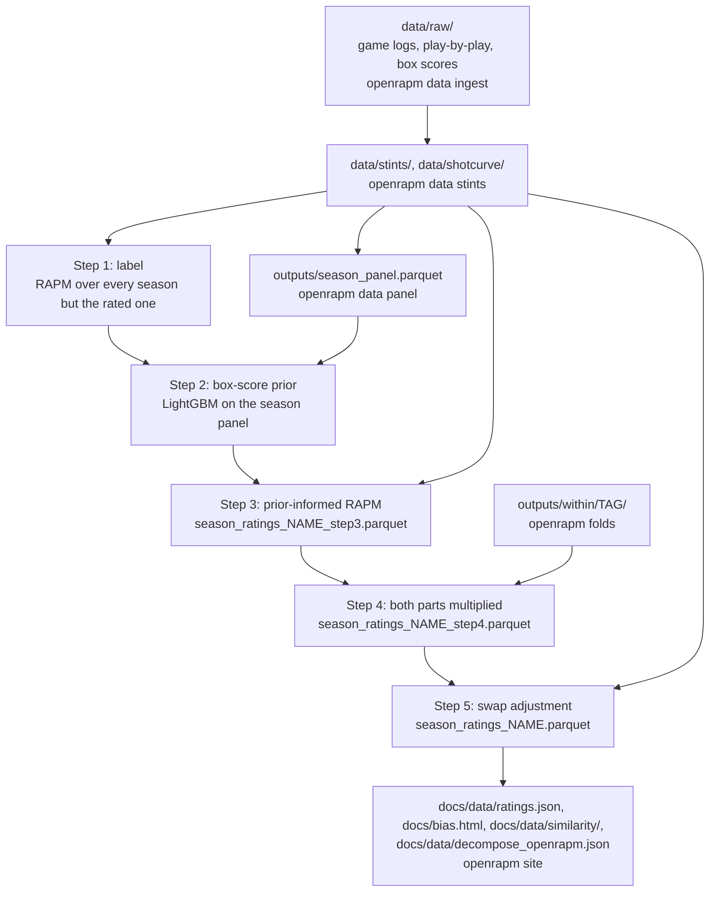

# How the ratings are built

Three data steps turn the NBA's play-by-play into a season panel, then five model steps turn the panel and
the stints into one rating per player per season. This file gives, for each step, what it is for, what it
reads, what it writes, the command, the settings (with the experiment in `notes/DECISIONS.md` that chose
them) and the code. Terms are defined in `GLOSSARY.md`.

Two words used throughout:

- **stint**: a stretch of play with the same ten players on the court. A row of every regression here is
  one stint seen from one side: five players on offence, five on defence, the points per 100 possessions
  the offence scored, weighted by the stint's possessions.
- **rated season**: the season whose ratings are being built. Each season is rated from its own games
  only; other seasons may teach the models' coefficients, never a player's rating directly.



`openrapm rate` runs steps 1-3, `openrapm shrink` step 4, `openrapm swap` step 5, and `openrapm build` all
five in one process (`src/openrapm/commands/build.py`). Each command writes its tables once, at the end.

## The data steps

### Ingest: the raw files

- **For:** everything else is built from these files.
- **Reads:** stats.nba.com through `nba_api`: each season's game log (LeagueGameLog), every game's
  play-by-play (PlayByPlayV3) and box score (BoxScoreTraditionalV3, and per period when the
  play-by-play cannot say who started a period); api.pbpstats.com's possessions per team-game as a
  cross-check from 2000-01.
- **Writes:** `data/raw/gamelog/`, `pbp/`, `box/`, `periodbox/`, `pbpstats_games/`.
- **Command:** `python -m openrapm data ingest 1997 2026 RS,PO` (RS regular season, PO playoffs). Days for
  all 37,986 games. A file already on disk is not fetched again, so a stopped run resumes. With
  `OPENRAPM_OFFLINE=1` a missing file stops the run instead of being fetched.
- **Code:** `src/openrapm/data/ingest.py`.

### Stints

- **For:** RAPM needs the ten players on the court for every possession (one team's turn with the ball,
  from when it gains the ball until the other team does or the period ends).
- **Reads:** `data/raw/`.
- **Writes:** per season and phase, `data/stints/{season}_{phase}.parquet` (the stints: lineups,
  possessions, points and the per-possession counters), `_diag.parquet` (one row of diagnostics per
  game), `_shots.parquet` (each game's shots per shooter) and `_names.parquet`;
  `data/stints/diagnostics_summary.parquet` (one row per season and phase); `data/shotcurve/` (each
  season's make probability by shot distance, fitted on every field-goal attempt of its regular season).
- **Command:** `python -m openrapm data stints 1997 2026 RS,PO`; `--force` rebuilds stints already on
  disk. About 46 minutes: the 60 season-phases (30 seasons, regular season and playoffs each) took 2,749
  seconds in total.
- **Code:** `src/openrapm/data/stints.py` (a season), `data/stint_parser.py` (one game: how a possession
  ends and who is on the court), `data/shot_curves.py`.

### The play-by-play parts

- **For:** the season panel's twelve play-by-play columns (`features.EVENT_RATES`), the parts of four box
  counts the stat-splits experiments (52-55) hand the prior beside the counts themselves.
- **Reads:** `data/raw/pbp/`. **Writes:** `data/event_counts/{season}.parquet`, one row per game, player
  and phase: defensive rebounds by the miss they ended (a free throw, a three, a two within 6 ft or logged
  without a location, a two from farther out), steals by the turnover they took (a pass or a lost ball),
  field-goal points and made threes with and without an assist, threes from the corner and above the break.
- **Command:** `python -m openrapm data events 1997 2026`; a cached season is read unless `--force`. About
  12 seconds a season. It prints each season's parts against its box score.
- **Code:** `src/openrapm/data/event_counts.py` (how each part is read).

### The season panel

- **For:** the box-score prior (step 2) and the swap adjustment's type model (step 5) read it.
- **Reads:** the stints, the box scores, the roles table (`data/cache/roles_RSPO.parquet`: share of team
  possessions, starts, age, per player-season) and the bio table (`data/cache/bio.parquet`: height,
  weight, draft pick). Its first run builds both tables, fetching the bio feed (`data/raw/bio/`), one
  request per season.
- **Writes:** `outputs/season_panel.parquet`, one row per player, season and side (offence "O", defence
  "D"): his possessions, 13 padded box-score rates per 100 possessions, role, score state, shot totals,
  career, body, team, his team's record with him on and off the court, and the twelve play-by-play parts
  (padded the same way, centred). It also stores each season's
  design pieces (what a regression design needs from that season's stints) in `data/cache/pieces/`, which
  every later step reuses.
- **Command:** `python -m openrapm data panel`; an existing panel is kept unless `--force`. 37 seconds in
  the last fresh build.
- **Settings:** each rate is padded toward the bin rate, the rate of players with about as many
  possessions (config.yaml `pad_target: poss_conditional`; padding toward the league rate instead, or with
  k halved or doubled, did no better: `git show archive/research-2026-09:FINDINGS.md`, section 21, "14.
  Flat: the padding behind the box rates"): padded = (n x rate + k x bin rate) / (n + k), with n his
  possessions and k measured per count and season from every player's odd- against even-numbered games. A
  200-possession player with 2.1 steals per 100, k = 450 and a bin rate of 1.4 is padded to
  (200 x 2.1 + 450 x 1.4) / 650 = 1.6.
- **Code:** `src/openrapm/data/panel.py`, `box_rates.py`, `on_court.py`, `data/roles.py`, `data/bio.py`,
  `data/designs.py`; `features.py` says what every column means.

## The five steps

### Step 1: the label (`rapm.py`)

- **For:** the box-score prior needs something to learn: each player's RAPM over every season except the
  rated one, one number per player per side for those seasons together.
- **Reads:** the designs of every season whose Finals are over, one design per target (below).
- **Writes:** nothing on disk; the labels go straight to step 2.
- **How:** each season's weighted least-squares normal equations are added up once (`SeasonSums`), so
  leaving a season out is one ridge solve on the other seasons' sums, not thirty refits. A player needs
  100 possessions to get a label.
- **Settings:**
  - the targets, one per side: offence `points_with_expected_free_throws` (made free throws replaced by
    the shooter's padded expectation), defence `points_with_expected_opponent_threes` (the same, with three
    quarters of the shooters' three-point luck taken off). `notes/DECISIONS.md`, "What was settled".
  - penalties 40,000 on offence and defence, 0 on the context columns ("Choose a training target's
    penalty on the end-to-end score", 2026-09-12). With 40,000, a player with 54,000 possessions keeps
    57% of his raw impact and one with 2,600 keeps 6%.
  - the defensive label is un-shrunk, the offensive one is not (experiment 22): label = beta / max(s,
    s_cap) + (1 - s / max(s, s_cap)) x m(tier), with s = n / (n + 40,000), s_cap the same at 4,444
    possessions, and m(tier) the un-shrunk level of his possession tier (0-500, 500-1,500, 1,500-4,444,
    4,444 and more). Experiment 1 of 2026-09-14 evening set the 4,444 and the tiers. Un-shrinking both
    sides helped the year-over-year test but made the order within each side worse and cut the consensus
    agreement from 0.771 to 0.680; un-shrinking defence alone passed every check (experiment 22).
- **Code:** `src/openrapm/rapm.py`; the design in `design.py` and `data/designs.py`; the targets'
  shooting adjustments in `data/shots.py`.

### Step 2: the box-score prior (`box_prior.py`)

- **For:** a player with few possessions has little evidence of his own; his box score says most of
  what is known about him.
- **Reads:** step 1's labels; the season panel, through `data.panel.trainable_panel`, which drops any
  season still being played; `params/booster_params_lgb1_tune2.json`.
- **Writes:** each player's prior per side for the rated season, handed to step 3. With
  `--save-models NAME`, every rated season's boosters (the fitted LightGBM models) to
  `outputs/prior_models_NAME.pkl`.
- **How:** each player's training rows are his career row (his box score averaged over every season he
  has outside the unseen ones) and a chunk row for every run of 1, 2 and 3 consecutive seasons, all
  carrying his career label; two inputs say how much evidence a row rests on (`row_possessions`,
  `row_seasons`). Players are sorted by label and assigned to five folds 0,1,2,3,4,4,3,2,1,0,..., and each
  player's prior comes from the booster fitted without his fold, so it cannot have learned his box score
  and returned his own label. The booster is then asked about the rated season's own box score.
- **Settings:**
  - the inputs: `hustle`, 18 on offence and 18 on defence: `no_career_counts` plus the hustle box score's counts,
    each summed over the games a rating is built from and missing before 2017 (experiment 76, adopted 2026-10-16);
    `no_career_counts` is `box_score_and_bio` (`features.SHIPPED`,
    without the on-court plus-minus, experiment 45) without the career counts -- career possessions before,
    seasons played before and seasons with his current team -- so the prior reads only the rated season's box
    score, role and body (experiment 59, adopted 2026-10-14; experiment 57 had counted them from each player's
    debut, `data/careers.py`);
  - chunk sizes 1, 2 and 3 (experiment 3);
  - five player folds ("The SPM memorises long-career stars, and the out-of-player prior removes it",
    2026-09-14);
  - LightGBM's settings in `params/booster_params_lgb1_tune2.json`, chosen by the with-or-without-you test itself:
    `scripts/checks/152_decider_tune.py`, 100 trials of Optuna's Gaussian-process sampler on ten seasons with the
    year-over-year test as a hard limit (experiment 76, adopted 2026-10-16).  Straight-line leaves on both sides,
    small trees and slow learning: the offence's trees are two splits deep, so its prior is close to a straight
    line in the box score.  Before it `lgb1_cols06`, tuned on the prior's error against career labels;
  - the training weight in its own column, `row_weight`, so it no longer overwrites body weight
    (experiment 46).
- **Code:** `src/openrapm/box_prior.py`, `features.py`.

### Step 3: prior-informed RAPM (`prior_rapm.py`)

- **For:** the season's own games decide how far each player moves from his prior.
- **Reads:** the rated season's designs (both targets) and step 2's priors.
- **Writes:** `outputs/season_ratings_NAME_step3.parquet`.
- **How:** minimise the sum over rows of w (y - Z r - C gamma - s_O P_O - s_D P_D)^2 + 13,037 (|r_O|^2 +
  |r_D|^2), with w the row's possessions, y its points per 100, Z the players' columns, r their
  coefficients, C the context columns and gamma their coefficients, and P_O and P_D the five offensive and
  five defensive priors on the court, summed; the prior scales s_O, s_D and gamma are not penalised. A rating is s x prior + r.
  The offence half of the table comes from the fit on the offence target, the defence half from the fit
  on the defence target. Then each season and side is centred: the possession-weighted mean rating is 0.
  2026's offensive prior scale is 2.35, so a player whose booster prior is +0.5 per 100 starts at +1.18.
- **Settings:** penalty 13,037 on both sides, one value for every season (experiment 2 of 2026-09-14
  evening).
- **Command:** `python -m openrapm rate` (steps 1-3); `--seasons 2026` rates one season, whose values
  equal the 2026 rows of a thirty-season run.
- **Code:** `src/openrapm/prior_rapm.py`, `commands/build.py`.

### Step 4: the prior shrink (`prior_shrink.py`)

- **For:** scored on games the rating never saw, the prior's part of a rating holds up less well than the
  games' part. Fitting those games' points on the ten players' summed parts, both coefficients free, gives
  0.70 for the prior's part on offence and 0.91 on defence, against 1.21 and 1.30 for the games' part
  (experiment 33b). From 2026-10-03 the step multiplied the prior's part only: multiplying the games' part as
  well tied on the year-over-year test (8.648 either way) and on the team-game held-out test (z -1.1). Since
  experiment 65 (adopted 2026-10-15) it multiplies both: the with-or-without-you test, which scores how a team's
  results move as its lineup changes, reads the games' part freed at -0.648, z -17.5, better in 30 of 30
  seasons, the year-over-year test a tie.
- **Reads:** a step-3 table; the within-season folds in `outputs/within/TAG/` (below).
- **Writes:** `outputs/season_ratings_NAME_step4.parquet`, and every season's multipliers in
  `outputs/csv/season_ratings_NAME_step4_multipliers.csv`.
- **How:** four multipliers per season, the prior's part and the games' part on offence and defence, from
  one weighted least-squares fit on the folds' held-back team-games; each part is multiplied by its own, and
  each season is centred again. The published multipliers, the defence factor included: the prior's part 0.659 to 0.728 on
  offence and 0.684 to 0.794 on defence; the games' part 1.186 to 1.393 on offence and 1.252 to 1.351 on defence.
- **Settings:**
  - the method (experiment 33b, adopted 2026-10-03), with the games' part freed (experiment 65, adopted
    2026-10-15; `ShrinkSettings.free_games_part`, `--no-free-games-part` holds it at 1);
  - both defensive multipliers times 0.866 in every season, chosen with the booster's settings by the same search
    (experiment 76, `ShrinkSettings.defence_factor`, `--defence-factor`);
  - the folds `tune2_early,tune2_within` (experiment 76's own folds), seasons 1997-2026 pinned, because the
    fold folder grew once and an unpinned rerun shrank harder (experiment 34's correction);
  - each season's multipliers from the 8 fold seasons nearest it (experiment 55, adopted 2026-10-12).
- **Command:** `python -m openrapm shrink --base season_ratings_NAME_step3`.
- **Code:** `src/openrapm/prior_shrink.py`, `data/within_folds.py`.

### Step 5: the swap adjustment (`swap_adjust.py`)

- **For:** inside a team, the same five keep playing together, so how a lineup's credit is split among them
  is barely identified. Lineup swaps (two lineups of one team that share four players) say which kinds of
  player the ratings give too much or too little credit.
- **Reads:** a step-4 table with every season, the stints (for the lineup swaps), the season panel (for
  the type features).
- **Writes:** `outputs/season_ratings_NAME.parquet`; with `--types`, `outputs/NAME_types.csv`.
- **How:** a type model (a ridge regression of each swap's unexplained result on the difference of the two
  swapped players' type features: 20 season-panel inputs and step 4's two prior parts, standardised)
  predicts each player's miss; half of it is applied; each team's total is given back by its own players
  in proportion to their share of its possessions; the spread inside teams is then held to step 4's. Team
  totals stay.
- **Settings:** half strength, the spread held within teams ("The swap adjustment with the spread held: it
  passes", adopted 2026-10-01); the give-back by share of possessions (experiment 41); the type model's
  ridge penalty 1e-4 x the mean diagonal of its Gram matrix, five player folds (player_id % 5). Half,
  because on the swap test half the type prediction kept most of full strength's gain in ordering
  teammates and tied on the gaps between them, where full strength made the gaps worse; the spread held,
  because without it the ratings came out about 12% wider on offence and 27% wider on defence and failed
  the year-over-year test (z +3.5), and with it they passed (z -5.2, 39 of 56).
- **Command:** `python -m openrapm swap --base season_ratings_NAME_step4`. A table of one season gets no
  swap adjustment, because the type model trains on the other seasons of the same table.
- **Code:** `src/openrapm/swap_adjust.py`, `swap_test.py` (the lineup swaps).

## The product setting and the test setting

`--setting product` (the default) builds the published ratings. `--setting test` builds the table the
year-over-year test scores: that test predicts the seasons either side of the rated one, so nothing fitted
for a season may have seen them.

| | product | test |
|---|---|---|
| step 1's labels and step 2's training rows leave out | the rated season | the rated season and the seasons either side |
| step 4's multipliers are fitted without | the rated season's folds | the rated season's folds and its neighbours' |
| step 5's type model trains on | every other season | seasons more than one away |
| default table | `outputs/season_ratings_product.parquet` | `outputs/season_ratings_test.parquet` |
| used by | the site | the year-over-year test |

Both settings live in `src/openrapm/settings.py` (`PRODUCT`, `TEST`). A thirty-season `build` takes
about 15 minutes in either.

## The within-season folds

Step 4 needs the ratings' misses on games they never saw. Misses on the neighbouring seasons would teach
it that a peak season comes back down the year after, so the misses come from the season's own games,
held back.

- **What:** each season's games (regular season and playoffs) are assigned at random to four folds,
  three times over: twelve folds a season. For each fold the season is rated from the other three
  quarters (the fit games), with every input rebuilt from those games alone and the saved boosters
  answering for the rebuilt rows, and scored on the fold (the test games).
- **Commands:** the boosters of 2017-2026 first (about 5 minutes), then the folds (about 8 minutes); a
  build then fits step 4 on them:

  ```bash
  python -m openrapm rate --setting test --seasons 2017-2026 --name for_folds --save-models mine
  python -m openrapm folds --models mine --base season_ratings_for_folds_step3 --tag mine_within
  python -m openrapm build --folds mine_within
  ```
- **Checks:** each season rebuilt from all of its games must equal its row of the base table before any
  fold is rated (`--reproduce-only` runs only this), and every fold's leak checks are written beside it
  and stop the run when one fails. `notes/WITHIN_SEASON_LEDGER.md` lists every input, what it is built
  from, and its check.
- **Writes:** `outputs/within/TAG/`: `folds_<season>.parquet` (game to fold), `players_*.parquet` (each
  player's rating and its parts, whole season and per fold), `test_*.npz` (the held-back team-games) and
  `fold_*.json` (each fold's error and leak checks).
- **Code:** `src/openrapm/commands/within_season.py`, `data/within_folds.py`.

## The similarity page (`similarity.py`)

- **For:** the site's Similarity tab: for each player-season, the most similar player-seasons of other players
  (the owner's design, 2026-10-12).
- **Reads:** the ratings table (each player-season's final rating and the season's games' part, `u_off` and
  `u_def`) and the season panel through `data.panel.trainable_panel` (every input the box-score prior reads for a
  rated season, both sides).
- **Writes:** `docs/data/similarity/player_seasons.json` and one file per season, each player-season's two lists.
- **How:** the pool is every player-season with 1,000 or more offensive possessions in a season whose Finals are
  over.  Each of the 34 inputs is standardised on the pool (minus its mean, over its standard deviation), and two
  player-seasons are as similar as the straight-line distance between their standardised inputs is small.  Every
  season of the picked player is left out of his lists: the 50 nearest player-seasons, and the 50 nearest
  players, each at his nearest season.  A classifier with one class per player-season, read for a Shepard-Luce
  similarity, was tried first and found a player's own seasons less well (`notes/DECISIONS.md`).
- **Settings:** in `commands/site.py`: the 1,000-possession minimum (the ratings page's), 50 matches and the
  opening view (Gary Payton II, 2022).
- **Command:** `python -m openrapm site --similarity` (33 seconds).  The inputs include the final ratings, so the
  page is rebuilt after every ratings build (`tests/test_similarity_site.py` fails otherwise).
- **Code:** `src/openrapm/similarity.py`, `commands/site.py`, `docs/similarity.html`.

## The OpenRAPM decomposition page (`decomposition.py`)

- **For:** the site's Decomposition tab, opened on OpenRAPM (a toggle at the top of the page switches to the vanilla
  RAPM page): every published rating split, offense and defense separately, into box score + on court + off court +
  team SOS + swap adjustment, which add up to the rating (the owner's design, 2026-10-13).  Total is the two sides'
  pieces added.
- **Reads:** the ratings table and its step-3 table (`outputs/season_ratings_product.parquet` and `_step3`), each
  season's two designs (step 1's targets for offense and defense, `data.designs.DesignCache`) and the box scores'
  teams (`data/raw/box`).
- **Writes:** `docs/data/decompose_openrapm.json`, one row per player-season of `ratings.json`.
- **How:** box score and swap adjustment are the table's `prior_off` / `prior_def` and `c_off` / `c_def`.  The
  games' part `u` (step 3's coefficient beyond the prior, times step 4's factor on it since experiment 65) is a
  weighted sum of the season's row outcomes, so grouping the rows splits it: the rows he is on the court for (on court), his team's rows without him, in games he
  played and games he missed (off court), and every other row (team SOS).  Step 3 is solved again for each season
  and target on the table's own priors to get the weights; `decomposition.py` has the equation.
- **Checks:** the run stops before writing unless the pieces add up to every rating, the refit reproduces every
  `u` and every prior scale in the table (1e-9; 1e-6 in 2020, whose solve needs a jitter), every coefficient is the
  sum of weight x outcome, the box scores name both teams of nearly every row, every player has a name, and the
  file's rows and ratings are `ratings.json`'s.  `tests/test_decompose_openrapm_site.py` checks the committed file
  against `ratings.json`.
- **Command:** `python -m openrapm site --openrapm-decomposition` (132 seconds).  It reads the ratings table, so it
  is rerun after every ratings build.
- **Code:** `src/openrapm/decomposition.py` (shared with the vanilla page: the rows' teams and the groups of rows),
  `commands/site.py`, `docs/decompose_openrapm.html`.

## Where the numbered scripts went

Until the 2026-10 cleanup each stage was a numbered script; the notes in `notes/` still cite them. They
are kept at the tag `archive/research-2026-10`, for example
`git show archive/research-2026-10:scripts/62_single_year_board.py` (retired).

| old script | what it did | now |
|---|---|---|
| 01 `ingest` | game logs, play-by-play, box scores | `openrapm data ingest` |
| 02 `stints` | stints and their diagnostics | `openrapm data stints` |
| 49 `role_panel` (with 65, 69, 86) | the season panel (65, 69 and 86 added the off-court, closeness and playoff-share columns) | `openrapm data panel` |
| 62 `single_year_board` | steps 1-3 | `openrapm rate`; all five steps are `openrapm build` |
| 97 `within_season` | the within-season folds | `openrapm folds` |
| 98 `calibrator` | a calibrator on the folds (not adopted) and the reader of a fold | the reader is `data/within_folds.py`; the calibrator is retired |
| 99 `prior_shrink` | step 4 | `openrapm shrink` |
| 91 `swap_adjust` | step 5 | `openrapm swap` |
| 52 `site` | `docs/data/ratings.json` | `openrapm site` |
| 76 `bias_groups` | `docs/bias.html` | `openrapm site --bias` |
| 83 `decompose_site` | the decomposition page's data | `openrapm site --decomposition` |
| 63, 64, 66, 70, 73, 88, 90, 95, 101, 113, 135, 137, 138 | the checks | `scripts/checks/`, same number and name |
| every other number | research | retired |

Old flags and names that the notes use, and what they are now:

| in the notes | now |
|---|---|
| 62 `--exclude_neighbours=1` | `--setting test` |
| 62 `--booster_params=lgb1`, `--save_models=X` | `--booster-params lgb1`, `--save-models X` |
| 62 `--features=boruta_noonc` | `--features box_score_and_bio` (the old name still works) |
| target `xpts_ft` | `points_with_expected_free_throws` |
| target `x3def_w0.25` (and `x3def`) | `points_with_expected_opponent_threes` (and `points_with_expected_opponent_threes_all`) |
| the noise control `noise_regroup2` | `--fold-assignment 1` |
| 99 `--rule=test`, `--tag=X` | `openrapm shrink --setting test --folds X` |
| 97 `--check_only` | `openrapm folds --reproduce-only` |
| `outputs/role_panel_season.parquet` | `outputs/season_panel.parquet`, every column renamed (`src/openrapm/data/legacy_names.py` maps each old name) |

## The checks

`scripts/checks/` holds the fourteen checks; each prints what it measures and reads the tables it is
handed without changing them.

| check | what it answers |
|---|---|
| `63_yoy.py` | the year-over-year test: how well a season's ratings predict the games of the seasons either side |
| `64_consensus_report.py` | rank agreement and spread against the consensus of public metrics |
| `66_compare.py` | two or more tables side by side for one season, as an HTML page (the 2026 top 20) |
| `70_tradeset.py` | the trade set: what a player's comings and goings say his rating did not know |
| `73_tradeloss.py` | the trade loss: which table leaves smaller trade-set corrections, same players |
| `88_yoy_by_player.py` | which players a year-over-year difference comes from, by quality tier, team change and age |
| `90_swap_test.py` | the swap test: does a table order teammates the way their lineup swaps do |
| `95_miss_by_group.py` | where the ratings miss most, by fifths of every statistic and by player type |
| `101_log_run.py` | one experiment's row in `experiments/runs.csv` |
| `113_swap_explain.py` | one team's swap adjustment, player by player, checked against the shipped table |
| `135_robust_review.py` | every test cut into slices, counted beside a noise control and a replicate (the same change built twice) |
| `137_stat_calibration.py` | calibration curves of the miss against each input (superseded for decisions by 138) |
| `138_heldout_audit.py` | on held-back games, are players high on some input rated too high or too low |
| `141_stepwise_inputs.py` | forward stepwise selection of the box-score prior's inputs, on one half of the seasons |

`scripts/experiment_chain.sh` runs the build and the standard readings for one experiment; `README.md`
and `CONTRIBUTING.md` say how.
