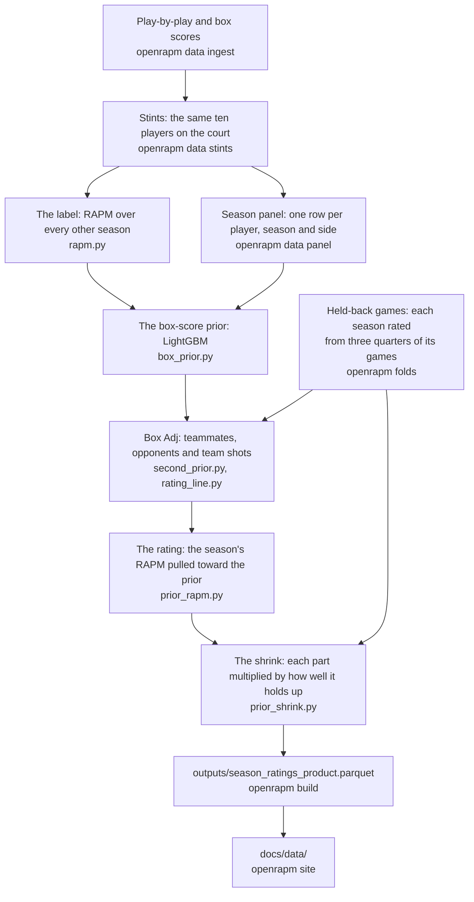

# OpenRAPM

Open player-impact ratings for the NBA, 1996-97 to now, in points per 100 possessions: one rating per player per
season, on offense and on defense. Live at <https://openrapm.com>.

Each rating is RAPM, regularized adjusted plus-minus: a ridge regression of the points scored on the ten players on
the court. Here the ridge pulls each player toward what his box score says rather than toward zero, and the result is
then corrected by how well each part of it predicted games it never saw.

The point of the project is the **test**, not any one model: every change is judged by whether it predicts games it
never saw. Anyone is welcome to propose one; the test decides.

## How a rating is made

| part | the question it answers | module | as shipped |
|---|---|---|---|
| the label | what has each player done over every other season? | `rapm.py` | one RAPM per player and side over every finished season but the rated one, penalty 40,000; the defensive label un-shrunk |
| the box-score prior | what does his box score say his label is? | `box_prior.py` | LightGBM on 18 offensive and 18 defensive inputs of the season panel, 10 averaged versions, each player answered only by versions that never saw him |
| Box Adj | how much of his box score did his teammates and opponents make? | `second_prior.py`, `rating_line.py` | a straight line on his box-score prior, his teammates' and opponents' priors with him on and off the court, his box rates, role and body, and his team's shots by zone with him on and off; it only moves credit between teammates |
| the rating | how far do this season's games move him from that prior? | `prior_rapm.py` | the season's ridge pulled toward the prior, penalty 13,037; how much the prior counts is set by the season's games |
| the shrink | how much of each part of a rating holds up on games it never saw? | `prior_shrink.py` | the prior's part and the games' part each multiplied, inside teams and between them, by factors fitted on held-back games |
| the swap adjustment | do same-four lineup comparisons say a teammate is over- or under-credited? | `swap_adjust.py` | off since 2026-10-20: Box Adj learns from the same comparisons before the ridge |

The code names the first, second, fourth, fifth and sixth rows steps 1 to 5; Box Adj sits between steps 2 and 3. Every
number above, and the experiment that set it, is in `src/openrapm/settings.py`.



Read from the finished ratings, not part of them: WOSA, wins over starter average (`wins.py`); the Power page
(`power_forecast.py`); the Bias page (`bias.py`); the Similarity page (`similarity.py`); the Detail view, which splits
each rating into its parts (`decomposition.py`). `PIPELINE.md` gives each part's inputs, outputs, command, settings
and code; `GLOSSARY.md` defines every term.

## Quick start

```bash
git clone https://github.com/bbstats/openrapm && cd openrapm
python -m venv .venv && source .venv/bin/activate     # .venv\Scripts\activate on Windows
pip install -e ".[dev]"
python examples/tutorial.py                           # the first steps on a made-up league, about 15 seconds
pytest
```

With uv, `uv venv` makes the environment and `uv pip install -e ".[dev]"` installs into it. Python 3.11 or later. The
install puts an `openrapm` command on your path; `python -m openrapm` is the same command, and it is what the docs
type.

**On a fresh clone with no data** every test passes or skips. A skipped test needs the scraped data, and its message
names the file or the command it is missing. The tests marked slow rebuild real seasons and run only when asked,
`pytest -m slow`. The one expected failure, `tests/test_vs_consensus.py::test_backup_bigs_are_not_in_the_top_twenty`,
is a known defect kept visible: Robert Williams and Jonathan Isaac sit higher than the consensus of public metrics
puts them. Tests cannot reach the network: `tests/conftest.py` blocks it.

You can read, change and test the model without downloading anything. The tutorial needs no data either: it plays
four seasons of a simulated league whose true player impacts are set in advance, runs the real code of the label,
the box-score prior and the rating on it, and prints how close each came. On the rated season plain RAPM reaches a
correlation of 0.74 with the true offensive impacts, the box-score prior alone 0.88, and the two together 0.93. The
simulated league has no lineup detail for Box Adj, and no held-back games for the shrink.

## Read the code in this order

Each module opens with the question it answers, the words it uses, the equation it implements and an example with
numbers. All are in `src/openrapm/`.

1. `design.py`: the regression's rows, player columns, context columns, target and weight.
2. `rapm.py`: the label.
3. `box_prior.py`: the box-score prior.
4. `second_prior.py`, then `rating_line.py`: Box Adj, and how its weights are fitted on held-back games.
5. `prior_rapm.py`: the rating.
6. `prior_shrink.py`: the shrink.
7. `swap_adjust.py`: the swap adjustment, off as shipped.

Then `settings.py`, every number the steps use and the experiment that set it, and `features.py`, every input the
box-score prior can read, with its meaning and formula.

## The two rules

**1. The season in progress is never trained on.** Every season may be loaded and rated. A season may be *fit* on
only once its Finals are over, which `src/openrapm/data/seasons.py` reads from the data rather than from a constant,
by asking whether any team has won the playoff games that win a title: sixteen since 2003, fifteen before. That
covers the labels, the box-score prior, Box Adj's line, the swap adjustment's model and every setting. The shrink's
multipliers read the held-back games of the 8 finished seasons nearest the rated one. The ridge of the rating itself
is exempt: a rating *is* a ridge coefficient, and solving it on the season in progress is the product, not a fit.
`tests/test_seasons.py` pins the cutoff; `tests/test_no_current_season.py` checks it end to end.

**2. Model code does not load its own data.** The data layer, `src/openrapm/data/`, reads the disk and the network;
the model layer, the other modules of `src/openrapm/`, is handed data and returns numbers; the commands,
`src/openrapm/commands/`, join the two. `tests/test_layer_boundary.py` enforces it. Add a data source freely, in the
data layer.

## The test that decides

**The within-season WOWY test decides** (`scripts/checks/151_wowy.py`; the owner, 2026-10-15). Each season is rated
from three quarters of its games, twelve times over, and scored stint by stint on the quarter held back, with each
team's own level in those games taken out, so what is scored is how the ratings split credit among teammates. The
reading is the mean of the 30 season-by-season differences in error, candidate minus incumbent, over its standard
error: a paired t-statistic, z, below zero better. A change must be better in every era, 1997-2006, 2007-2016 and
2017-2026, read beside the noise control: the incumbent rebuilt with only the box-score prior's split of players into
its five training groups changed, which moves the test by about 0.01 on its own.

**The year-over-year test guards it** (`scripts/checks/63_yoy.py`): rate a season from its own games, then predict
every stint of the season before and of the season after from the ten players' ratings alone, refitting only that
season's intercept and home edge. The misses are summed to team-games, one team's points in one game, so the noise of
single possessions cancels before a miss is squared. The score, `game_armse` in `src/openrapm/scoring.py`, is the
root of the team-game mean squared error times the square root of 2 / pi, so it reads as a typical miss in points per
100: 56 readings, 28 seasons each predicted from the season before and from the season after. Each side is read with
its spread matched to the incumbent's, since a wider or narrower table moves this test on its own.

Both tests print the plain z, which adoptions have been read on, and beside it a z that counts readings sharing
seasons together: `z_clustered` and `z_newey_west`.

A change is adopted on the owner's word when:

- the within-season WOWY test is better in every era, against the noise control's own movement; a bug fix needs only
  a tie;
- the year-over-year test is not worse at a paired z of +2;
- the 2026 top 20, side by side with the incumbent's (`scripts/checks/66_compare.py`), is not worse in the owner's
  reading.

The consensus of public metrics (`scripts/checks/64_consensus_report.py`) is a sanity check, never a fitting target:
a gross miss can veto a change. The incumbent and its noise control are named at the top of
`scripts/experiment_chain.sh`, which builds a candidate and takes every reading in one command:

```bash
bash scripts/experiment_chain.sh NAME DEFENSIVE_TARGET ["EXTRA RATE FLAGS"]
bash scripts/experiment_chain.sh noise_control points_with_expected_opponent_threes_late_as_scored "--fold-assignment 1"
```

The second line is a noise control. `CONTRIBUTING.md` says what a pull request has to show and how an experiment is
logged.

## Building the ratings

Everything under `data/` and `outputs/` is rebuilt by the commands below, and none of it is in git; the one
exception is `data/external/consensus.csv`, a snapshot of public metrics. Times are from the project's machine, every
linear-algebra library on one thread; `--jobs N` splits seasons over N processes where free memory allows, about 5.5
GB each.

The data, once:

```bash
python -m openrapm data ingest 1997 2026 RS,PO      # days; a file already on disk is not fetched again
python -m openrapm data stints 1997 2026 RS,PO      # about 46 minutes
python -m openrapm data events 1997 2026            # about 12 seconds a season
python -m openrapm data careers                     # about 13 minutes
python -m openrapm data hustle-games 2017 2026      # one request a game: the hustle inputs, from 2017
python -m openrapm data panel                       # under a minute
python -m openrapm data panel --so-far 0.25,0.5,0.75
```

The model, in four passes, because Box Adj and the shrink are both fitted on held-back games of a build before them:

```bash
# 1. ratings without Box Adj, at the test setting, keeping the boosters; their held-back games
python -m openrapm rate --setting test --seasons 1997-2026 --second-prior "" --name base --save-models base --jobs 4
python -m openrapm folds --models base --base season_ratings_base_step3 --seasons 1997-2016 --tag base_early --jobs 4
python -m openrapm folds --models base --base season_ratings_base_step3 --seasons 2017-2026 --tag base_within --jobs 4
# 2. Box Adj's line, fitted on those held-back games through the ridge
python -m openrapm second-prior --models base --folds base_early,base_within --tag mine_line --target rating
# 3. ratings with the line; their held-back games, at a quarter and at a tenth held back
python -m openrapm rate --setting test --seasons 1997-2026 --second-prior mine_line --name mine --save-models mine --jobs 4
python -m openrapm folds --models mine --base season_ratings_mine_step3 --seasons 1997-2016 --tag mine_early --jobs 4
python -m openrapm folds --models mine --base season_ratings_mine_step3 --seasons 2017-2026 --tag mine_within --jobs 4
python -m openrapm folds --models mine --base season_ratings_mine_step3 --seasons 1997-2026 --tag mine_k10 --folds-per-repeat 10 --jobs 4
# 4. the published tables and the site's files
python -m openrapm build --second-prior mine_line --folds mine_early,mine_within --extrapolate-folds mine_k10
python -m openrapm site --openrapm-decomposition --similarity --power --bias
```

A rating pass takes about 3 minutes a season a process; the 120 held-back sets of ten seasons about 12 minutes; the
final `build` rates 31 seasons and then each finished season from its regular season alone for WOSA: 12,792 seconds in
one process on 2026-11-10. `openrapm build` writes `outputs/season_ratings_product.parquet` with the tables before
the shrink and before the swap adjustment beside it; `build --setting test --name NAME` writes the table the tests
score.

What a fresh build cannot repeat bit for bit: the published Box Adj line was fitted on the held-back games of an
earlier build, so a line refitted as above differs a little. Each command checks what it reads: `build` stops in
seconds, before rating anything, when the held-back games it names are missing, and `rate` stops when Box Adj's line
is.

`python -m openrapm <command> --help` lists every option. `--config FILE`, before the command, or the environment
variable `OPENRAPM_CONFIG`, points every command at another `config.yaml`; give it absolute paths, since relative
ones are read from where the code sits.

## The season in progress

`scripts/daily_update.sh` rates the season in progress every morning at 6 AM Eastern, on the project's machine, and
publishes it: the night's games are fetched, checked, built into stints and rated in place of yesterday's season,
every finished season unchanged. Nothing is trained on the season in progress. `PIPELINE.md`, "The morning job",
lists its steps and what keeps it safe with nobody looking. Before any push to `main`, `bash scripts/publish_check.sh`
runs what GitHub runs, on a clone with no data: the lint check, every test and the tutorial.

## Layout

    src/openrapm/
      rapm.py box_prior.py second_prior.py rating_line.py prior_rapm.py prior_shrink.py swap_adjust.py
                        how a rating is made
      settings.py       every number the build uses, and the experiment that set it
      features.py       the box-score prior's inputs: name, meaning, formula
      design.py         the regression design: players, context columns, box counts
      box_rates.py      padded per-100 box-score rates
      on_court.py       a team's record with a player on and off the court
      scoring.py        how ratings are scored on games they never saw
      wins.py           WOSA: the win model, leverage, the pace ridge, the bar, the wins
      power_forecast.py the Power page's one rating
      bias.py           the Bias page: OpenRAPM against a consensus of outside systems, stat by stat
      similarity.py     the Similarity page: each player-season's nearest player-seasons
      decomposition.py  the Detail view: which rows of a ridge fit a rating comes from
      consensus.py swap_test.py trade_set.py player_types.py simulate.py
                        the consensus check, lineup swaps, trade sets, player types, the simulated league
      data/             the data layer: everything that reads or writes the disk or the network
      commands/         the openrapm command line
    scripts/checks/     the numbered checks: the two tests, the top-20 page, and the one-off studies; PIPELINE.md lists each
    scripts/experiment_chain.sh, scripts/daily_update.sh and its helpers
    examples/tutorial.py
    tests/
    params/             LightGBM settings, the Power page's weights, the held-out audit's input groups, player names
    config.yaml         seasons, data constants and paths
    docs/               the published site
    notes/              the project's history
    experiments/runs.csv    one row per experiment

## Where the history lives

- `notes/HANDOFF.md`: where the work stands, what waits on the owner, and the commands a next session runs.
- `notes/DECISIONS.md`: every experiment, what the test settled and what it rejected, and the measurement traps
  that have produced confident wrong numbers here before. Read the traps before trusting a number.
- `notes/WITHIN_SEASON_LEDGER.md`: what a set of held-back games sees, what it never sees, and the check for each.

The notes cite numbered scripts such as `scripts/62_single_year_board.py`, retired in the 2026-10 cleanup and kept at
the tag `archive/research-2026-10`: `git show archive/research-2026-10:scripts/62_single_year_board.py`. A
`FINDINGS N.N` comment points at the research log kept at the tag `archive/research-2026-09`. Code removed in the
cleanup of 2026-11-16, the three box-score priors that lost their tests and the retired vanilla RAPM page, is kept at
the tag `archive/research-2026-11`.

## Contributing

See `CONTRIBUTING.md`. In one line: change the model layer, run the test against what ships, and report every variant
you tried, not just the one that won.

## Using the code and the ratings

Ratings by Nathan Walker. Use them with credit and a link to openrapm.com. No bulk copying or scraping.

The code is MIT licensed, `LICENSE`: fork it, change it, run it. The published ratings, the site and `docs/data/`,
carry their own terms in `LICENSE-RATINGS.md`: use and quote them with credit, do not republish the table or mirror
the site without permission, no AI crawling. `docs/robots.txt` says the same to crawlers.
