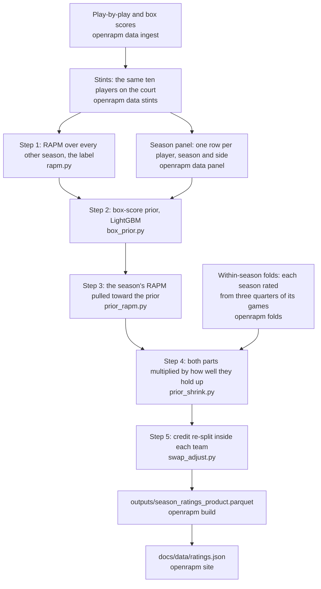

# OpenRAPM

Open player-impact ratings for the NBA, 1996-97 to now, in points per 100 possessions, one rating
per player per season. Live at <https://bbstats.github.io/openrapm/>.

Each rating is RAPM (regularised adjusted plus-minus: a ridge regression of the points scored on the ten
players on the court) pulled toward what the player's box score says, then corrected on games the
ratings never saw.

The point of the project is the **test**, not any one model: every change is judged by whether it
predicts games it never saw. Anyone is welcome to propose one; the criterion decides.

## Quick start

```bash
git clone https://github.com/bbstats/openrapm && cd openrapm
python -m venv .venv && source .venv/bin/activate     # .venv\Scripts\activate on Windows
pip install -e ".[dev]"
python examples/tutorial.py                           # steps 1-3 on a made-up league, about 15 seconds
pytest
```

With uv, `uv venv` makes the environment and `uv pip install -e ".[dev]"` installs into it. Python 3.11 or
later.
The install also puts an `openrapm` command on your path; `python -m openrapm` is the same command, and
it is what this file types.

**On a fresh clone with no data**, `pytest` gives 548 passed, 10 skipped and 1 expected failure, in
about 50 seconds (run on 2026-10-13, Python 3.12, Windows). The 7 slow tests rebuild real seasons and
are left out unless you ask for them (`pytest -m slow`). The 10 skips need the scraped data (game logs,
stints, box scores), and each skip message names the file or the command it is missing. The expected
failure is
`tests/test_vs_consensus.py::test_backup_bigs_are_not_in_the_top_twenty`: Robert Williams and Jonathan
Isaac sit higher than the consensus of public metrics puts them, a known defect kept visible. Tests
cannot reach the network: `tests/conftest.py` blocks it, and `tests/test_network_block.py` checks the
block.

You can read, change and test the model without downloading anything.

The tutorial needs no data either. It plays four seasons of a simulated league whose true player
impacts are set in advance, runs the real code of steps 1-3 on it, and prints after each step how close
the ratings came. On the rated season, plain RAPM (step 1) reaches a correlation of 0.74 with the true
offensive impacts, the box-score prior alone 0.88, and the two together (step 3) 0.93.

## Read the code in this order

Each step is one module in `src/openrapm/`. Each opens with the question it answers, the words it uses,
the equation it implements and an example with numbers.

0. `design.py`, its docstring first: the regression design that steps 1 and 3 read (rows, player columns,
   context columns, target, weight), with a one-stint example.
1. `rapm.py`, step 1: given the ten players on the court, who was responsible for the points? Plain
   RAPM, and the label step 2 learns: each player's RAPM over every season except the rated one.
2. `box_prior.py`, step 2: what does a player's box score say his RAPM is? LightGBM (gradient-boosted
   trees), fitted so that no player's prior comes from a model that saw his own rows.
3. `prior_rapm.py`, step 3: how far do the season's own games move each player from that prior?
4. `prior_shrink.py`, step 4: how much of each part of a rating, the prior's and the games', holds up on
   games the rating never saw?
5. `swap_adjust.py`, step 5: inside each team, which players do the lineup swaps say get too much or too
   little credit?

Then `settings.py` (every number the five steps use, and the experiment that set it) and `features.py`
(every input the prior can read, with its meaning and formula). `GLOSSARY.md` defines each term.

## The five steps



`PIPELINE.md` gives each step's inputs, outputs, command, settings and code.

## Building the ratings from scratch

Everything under `data/` and `outputs/` is rebuilt by these commands, and none of it is in git (the one
exception is `data/external/`, a snapshot of public metrics). The times are from the last full runs on
the project's machine, every linear-algebra library on one thread.

```bash
python -m openrapm data ingest 1997 2026 RS,PO
python -m openrapm data stints 1997 2026 RS,PO
python -m openrapm data events 1997 2026
python -m openrapm data panel
python -m openrapm rate --setting test --seasons 2017-2026 --name for_folds --save-models mine
python -m openrapm folds --models mine --base season_ratings_for_folds_step3 --tag mine_within
python -m openrapm build --folds mine_within
python -m openrapm site --bias --decomposition --openrapm-decomposition --similarity
```

1. **`data ingest`** fetches each season's game log and every game's play-by-play and box score from
   stats.nba.com: 37,986 games over 1997-2026, regular season (RS) and playoffs (PO). It takes days. A
   file already on disk is not fetched again, so stopping and restarting it is fine.
2. **`data stints`** turns each game's play-by-play into stints (a stint is a stretch of play with the
   same ten players on the court) and fits each season's shot curve (the league's make probability by
   distance). About 46 minutes: the 60 season-phases (30 seasons, regular season and playoffs each) took
   2,749 seconds in total.
3. **`data events`** counts, from the play-by-play, the parts of four box counts (defensive rebounds by
   the miss they ended, steals by the turnover they took, points and threes by the assist and the spot),
   about 12 seconds a season. **`data panel`** then writes the season panel,
   `outputs/season_panel.parquet`: one row per player, season and side, with his padded box-score rates and
   their play-by-play parts, role, career and body. 37 seconds in the last fresh build.
   Its first run also builds the roles table and fetches the bio feed, one request per season.
4. **The within-season folds**, which step 4 is fitted on. `rate --setting test --save-models` rates
   2017-2026 and saves every season's boosters (the fitted LightGBM models): about 5 minutes. `folds`
   then rates each of those seasons from three quarters of its games with those boosters, twelve times a
   season, and stores the misses on the quarter held back: about 8 minutes. Rebuilt from the same data,
   these folds give step 4 exactly the multipliers the shipped folds give (`weightfix_within`, the
   default of `--folds`).
5. **`build`** runs the five steps for all thirty seasons and writes `outputs/season_ratings_product.parquet`,
   the published table, with its step-3 and step-4 tables beside it: 927 seconds in the last run.
   `build --setting test --folds mine_within --name weightfix` (874 seconds in the last run) writes the
   table the year-over-year test scores, under the incumbent's name, so the chain and the checks find it.
   Without `--folds`, `build` and `shrink` read `outputs/within/weightfix_within/`, which a fresh build
   does not have; they stop at step 4 with "no folds in ...", after steps 1-3 have run.
6. **`site`** writes `docs/data/ratings.json` (under a second); `--bias` adds `docs/bias.html`;
   `--decomposition` fits plain RAPM for every season and every three-season window for
   `docs/data/decompose_1y.json` and `decompose_3y.json` (319 seconds in the last run); `--similarity` writes
   `docs/data/similarity/`, each player-season's nearest player-seasons of other players (33 seconds);
   `--openrapm-decomposition` solves step 3 again for every season and writes `docs/data/decompose_openrapm.json`,
   each published rating split into box score, on court, off court, team SOS and swap adjustment (132 seconds;
   run it after every `build`).

`python -m openrapm <command> --help` lists every option. `--config FILE`, given before the command (or
the environment variable `OPENRAPM_CONFIG`), points every command at another `config.yaml`, so a check
can run in a scratch folder.

## The two rules

**1. The current season is never trained on.** Every season may be loaded and rated. A season may be
*fit* on only once its Finals are over, which `src/openrapm/data/seasons.py` reads from the data rather
than from a constant, by asking whether any team has won the playoff games that win a title (sixteen
since 2003, fifteen before). That covers the labels, the box-score prior, step 5's type model and every setting. Step 4's
multipliers are not gated there: they read only the folds of 2017-2026, a pinned setting
(`settings.ShrinkSettings`). The ridge of step 3 is exempt, because a rating *is* a ridge coefficient
and solving it on the season in progress is the product rather than a fit. `tests/test_seasons.py` pins
the cutoff; `tests/test_no_current_season.py` checks it end to end: the season in progress is dropped
from every read that trains, and replacing it with noise moves no training row by one byte.

**2. Model code does not load its own data.** The data layer, `src/openrapm/data/`, reads the disk and
the network; the model layer, the other modules of `src/openrapm/`, is handed data and returns numbers;
the commands, `src/openrapm/commands/`, join the two. `tests/test_layer_boundary.py` enforces it: a model
module may not open a file or import the data layer, and only the commands and `__main__.py` import
the commands. Add a data source freely (tracking data, a different feed, anything), but add it in the data
layer.

## The test that decides, and how to run an experiment

**The year-over-year test** (`scripts/checks/63_yoy.py`): rate a season from its own games, then predict
every stint of the season before and of the season after from the ten players' ratings alone, refitting
only that season's intercept and home edge. The misses are summed to team-games (one team's points in
one game), so the noise of single possessions cancels before a miss is squared.

The score, `game_armse` (`src/openrapm/scoring.py`), is sqrt(team-game mean squared error) x sqrt(2 / pi),
in points per 100 possessions. The mean squared error weights each team-game by its possessions. The
factor sqrt(2 / pi) = 0.798 is the ratio of the mean absolute deviation to the standard deviation of a
normal error, so the score reads as a typical miss rather than a root mean square. It is taken over 28
scored seasons (1998-2025), each predicted from the season before and from the season after: 56
observations. The incumbent, `outputs/season_ratings_weightfix.parquet` (experiment 46), reads
**8.5857**. The tables it scores are built at the test setting (`openrapm build --setting test`), so
nothing fitted for a season has seen the two seasons that score it.

**The paired z**: for each of the 56 observations, the candidate's team-game mean squared error minus the
incumbent's; the mean of those differences divided by its standard error (a paired t-statistic). Below
zero is better.

A change is adopted when all four hold; ties go to the simpler version.

- Its paired z is -2 or below. A bug fix, or a fix that removes a bias the held-out audit
  (`scripts/checks/138_heldout_audit.py`) counts, needs only a tie: z between -2 and +2
  (`notes/DECISIONS.md`, "The Robustness pass").
- The consensus shows no gross miss. Experiment 2's rank agreement of 0.570 / 0.656 / 0.651 against a
  minimum of 0.75 was gross and vetoed it; 0.759 against the minimum of the time, 0.76, was not a veto;
  a miss in between (defence 0.689, 8% under, 2026-09-14) went to the owner. The minimum is
  `MIN_RANK_AGREEMENT` in `src/openrapm/consensus.py`.
- The trade loss is not clearly worse. There is no cutoff: experiment 33b shipped with its defensive trade
  loss worse at z +5.5, a difference of 0.0007 on a 0.248 scale.
- The 2026 top 20 on the side-by-side page (`66_compare.py`) is not worse in the owner's reading.

`GLOSSARY.md` defines the consensus and the trade loss; `CONTRIBUTING.md` says what a pull request has to
show.

On a fresh build, make the incumbent's files once, then name your folds on every chain:

```bash
python -m openrapm build --setting test --folds mine_within --name weightfix
python scripts/checks/70_tradeset.py --rankings=outputs/season_ratings_weightfix.parquet --team_effects=team --out=tradeset_weightfix
INC_FOLDS=mine_within bash scripts/experiment_chain.sh NAME DEFENSIVE_TARGET
```

The first writes the incumbent; the second writes its trade-set corrections, which every chain's trade
loss is paired against. On the project's machine both exist and `INC_FOLDS` can be left out.

One experiment is one command:

```bash
bash scripts/experiment_chain.sh NAME DEFENSIVE_TARGET ["EXTRA RATE FLAGS"]
bash scripts/experiment_chain.sh noise_control points_with_expected_opponent_threes "--fold-assignment 1"
```

The second line is the noise control: the incumbent rebuilt with only the players' assignment to the
prior's five folds changed, which shows how far the readings move when nothing real has changed. The
chain builds the candidate at the test setting, then reads it against the incumbent:

- the year-over-year test (`63_yoy.py`);
- the consensus: rank agreement with a blend of public metrics (`64_consensus_report.py`);
- the 2026 top 20, side by side, as an HTML page (`66_compare.py`);
- the swap test: does it order teammates the way their lineup swaps do (`90_swap_test.py`);
- the year-over-year difference by player-quality tier: top 30, 31-90, 91-150, 151-300, 301+
  (`88_yoy_by_player.py`);
- the trade loss: how much a player's comings and goings in the seasons either side correct his rating
  (`70_tradeset.py`, then `73_tradeloss.py`).

Every reading goes to `outputs/NAME_chain.log`. A reading that fails is logged and the chain goes on;
the last line names every reading that failed. The chain does not log the experiment: afterwards,
`scripts/checks/101_log_run.py --name=NAME --exp=<number> --incumbent=weightfix ...` adds its row to
`experiments/runs.csv` (`CONTRIBUTING.md` gives the whole command).

## Layout

    src/openrapm/
      rapm.py box_prior.py prior_rapm.py prior_shrink.py swap_adjust.py    the five steps
      settings.py       every number the steps use, and the experiment that set it
      features.py       the prior's inputs: name, meaning, formula
      design.py         the regression design: players, context columns, box counts
      box_rates.py      padded per-100 box-score rates
      on_court.py       a team's record with a player on and off the court
      scoring.py        how ratings are scored on games they never saw
      similarity.py     the similarity page: each player-season's nearest player-seasons
      decomposition.py  the decomposition pages: which rows of a ridge fit a rating comes from
      swap_test.py trade_set.py consensus.py player_types.py simulate.py
      data/             the data layer: everything that reads or writes the disk or the network
      commands/         the openrapm command line
    scripts/checks/     the 14 checks: the year-over-year test, the consensus, the trade loss, ...
    scripts/experiment_chain.sh
    examples/tutorial.py
    tests/
    params/             LightGBM settings, the held-out audit's input groups, player names
    config.yaml         seasons, data constants and paths
    docs/               the published site
    notes/              the project's history
    experiments/runs.csv    one row per experiment

## Where the history lives

- `notes/HANDOFF.md`: where the work stands, what is waiting on the owner, and the commands a next
  session runs.
- `notes/DECISIONS.md`: every experiment, what the test settled and what it rejected, and the
  measurement traps that have produced confident wrong numbers here before. Read the traps before
  trusting a number.
- `notes/WITHIN_SEASON_LEDGER.md`: what a within-season fold sees, what it never sees, and the check for
  each.

The notes cite numbered scripts such as `scripts/62_single_year_board.py`, retired in the 2026-10
cleanup and kept at the tag `archive/research-2026-10`
(`git show archive/research-2026-10:scripts/62_single_year_board.py`); `PIPELINE.md` maps each to
today's command. A `FINDINGS N.N` comment points at the research log kept at the tag
`archive/research-2026-09` (`git show archive/research-2026-09:FINDINGS.md`).

## Contributing

See `CONTRIBUTING.md`. In one line: change the model layer, run the test against what ships, and
report every variant you tried, not just the one that won.

MIT licensed.
